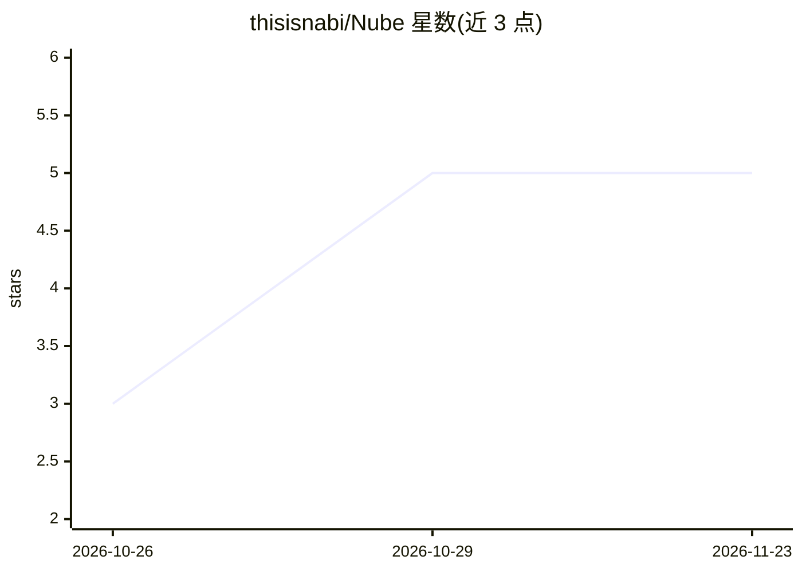

# thisisnabi/Nube

⭐ 5 · Go · 推送 2026-10-24 · [GitHub](https://github.com/thisisnabi/Nube) · 个人维护 · 中文 README

**让 AI agent 以沙箱、预算、可审计工作负载运行的编排器**

用 Go 从零实现的 Kubernetes 类容器编排器，核心场景是把 AI agent 声明为工作负载运行：每个任务在独立 pod 中执行，模型命令进入沙箱容器，风险工具调用等待人工批准，每次运行带 token/步骤/时间预算、完整调用 trace、会话记忆与 cron 调度。单一二进制同时充当控制面、节点守护进程、CLI 与仪表盘，支持 Docker/Podman、WireGuard 网络、Raft 高可用，并内置 MCP server 让 agent 反向操作集群。README 明确面向 homelab、个人项目与学习编排器原理，不宣称可替代生产级 Kubernetes。

## 筛选速览

| 维度 | 判定 | 备注 |
|---|---|---|
| AI 角色 | `ai-ecosystem` | LLM/agent 周边工具 |
| 许可风险 | `none` | — |
| 部署形态 | `library` | 以包/库形式分发 |
| 模型依赖 | local-ok | 支持本地模型 |
| 硬件要求 | — | 无带数字的原话,不猜 |
| 安装摩擦 | `low` | 无编译、无系统依赖或容器化 |
| 成熟度 | — | 结构信号不足 |

## 能力要点

- 每个 agent 运行是独立 pod：沙箱容器 + requireApproval 人工审批 + 预算与 trace
- 单二进制编排器：Raft HA、WireGuard 网络、Docker/Podman 运行时、内置仪表盘
- 通过官方 Anthropic SDK 或任意 OpenAI 兼容服务器接入模型
- 内置 MCP server 与 agent 角色，agent 可在审批与审计下操作集群

## 适用场景

- 在 homelab 多台 Linux 机器上编排容器与 AI agent
- 让 agent 执行任务时强制人工审批风险操作并控制 token 开销
- 学习 Kubernetes 类编排器（调度、自愈、网络、存储）的内部实现
- 通过 MCP 让 Claude Code 等 agent 管理集群资源

## 场景标签

`Agent 框架` · 领域:Agent 开发

## 证据(README 行号)

> L5: Nube **runs AI agents as workloads**. You declare an agent (a model, instructions and tools), and every task it gets
> L34: |**Any model**|Claude through the official Anthropic SDK, or any OpenAI-compatible server (vLLM, Ollama ...) runnin
> L90: |**Runtimes**|Docker or Podman (through its Docker-compatible API), chosen per node|

## 星数曲线

2026-10-26 3 → 2026-11-23 5（+2）

---
*卡片 v1 · prompt 1.4 · 生成 2026-11-21 · 置信度 high · 依据 README sha `c7875e0be20e` · [字段定义](../../DATASET.md)*
