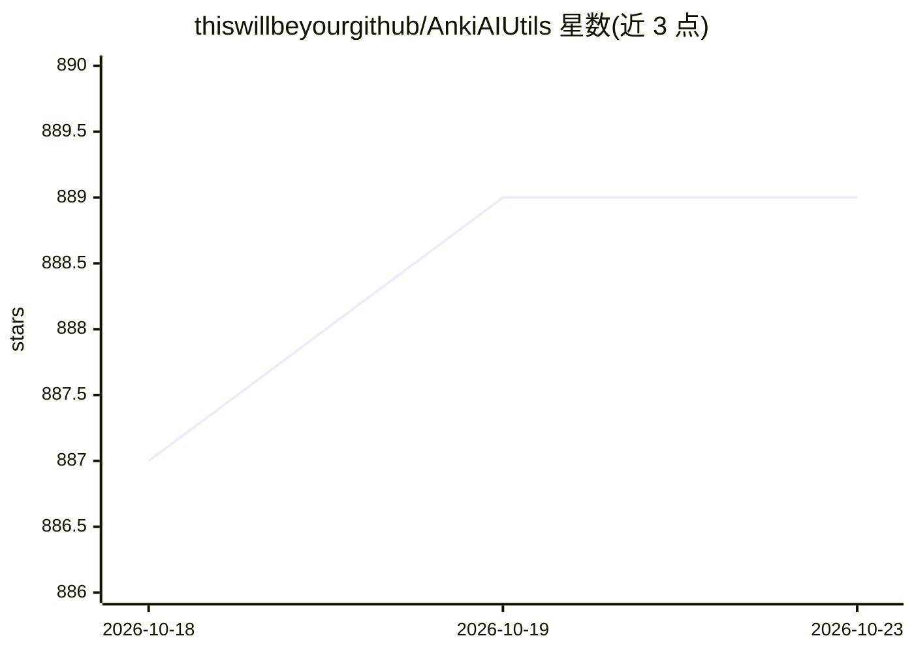

# thiswillbeyourgithub/AnkiAIUtils

⭐ 889 · Python · AGPL-3.0 · 推送 2026-06-01 · [GitHub](https://github.com/thiswillbeyourgithub/AnkiAIUtils) · 个人维护

**用 LLM 自动增强 Anki 卡片的脚本集：解释/助记/插图**

面向 Anki 用户的 Python 脚本集合，包含五个工具：Illustrator（用 DALL-E2/3 或 Stable Diffusion 生成记忆插图）、Reformulator（改写卡片、保留 cloze 与媒体）、Mnemonics Creator（含 Major System 批量生成助记）、Explainer（为答错的卡片生成解释）、Mnemonics Helper（独立于 Anki 的交互式 CLI）。通过 LiteLLM 支持各 LLM 提供商，直接就地修改 Anki 笔记并兼容全部 Anki 客户端。作者自述发布仓促，部分文档或脚本可能不精确，希望社区将其打包为 Anki 插件。

## 筛选速览

| 维度 | 判定 | 备注 |
|---|---|---|
| AI 角色 | `ai-native` | 本体是模型或模型工具 |
| 许可风险 | `viral` | AGPL-3.0 |
| 部署形态 | `library` | 以包/库形式分发 |
| 模型依赖 | — | README 未给出锁定关系 |
| 硬件要求 | — | 无带数字的原话,不猜 |
| 安装摩擦 | `low` | 无编译、无系统依赖或容器化 |
| 成熟度 | `idea` | |

## 能力要点

- 每日自动增强答错卡片：解释、助记、插图
- 通过 LiteLLM 支持各 LLM 提供商与模型
- 就地修改 Anki 笔记，兼容 Windows/Mac/Linux/Android/iOS 全客户端
- 助记生成支持 Major System 并复用用户自有助记库

## 适用场景

- 医学等长期记忆学习中对答错的卡片自动补充解释与助记
- 批量改写措辞不佳或格式过时的旧卡片
- 为视觉型学习者生成记忆宫殿式图像助记

## 场景标签

`图像生成` `AI 写作` · 领域:内容生成

## 证据(README 行号)

> L2: A powerful suite of AI-powered tools to enhance your Anki) flashcard learning experience by automatically improving 
> L7: **Those scripts make it so that every failed note will automatically have new fields containing explanations, mnemon
> L24: - **Provider Agnostic**: Supports all LLM providers and models through LiteLLM, letting you choose the best option 

## 星数曲线

2026-10-18 887 → 2026-10-23 889（+2）

---
*卡片 v1 · prompt 1.4 · 生成 2026-10-21 · 置信度 mid · 依据 README sha `e9a4d4367380` · [字段定义](../../DATASET.md)*
