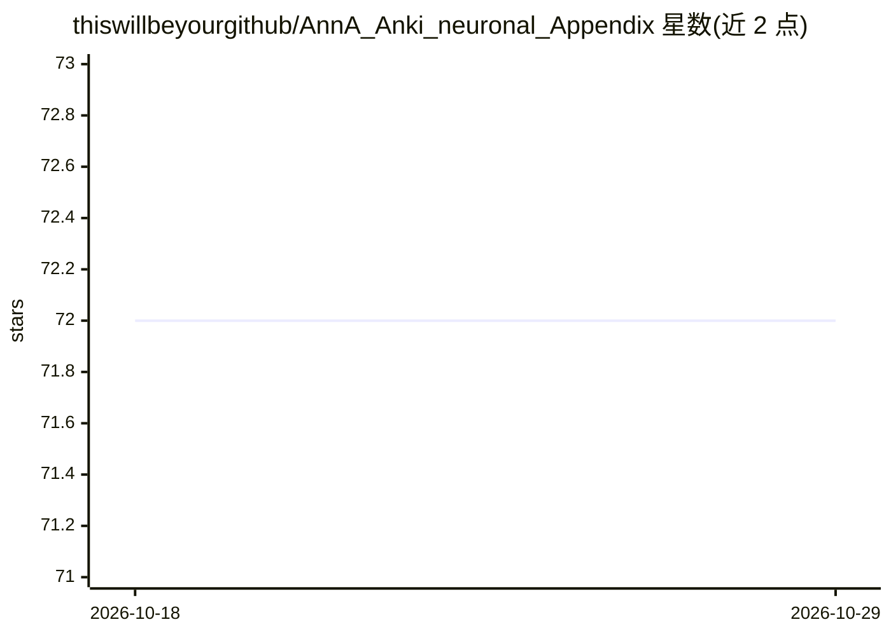

# thiswillbeyourgithub/AnnA_Anki_neuronal_Appendix

⭐ 72 · Python · AGPL-3.0 · 推送 2025-12-15 · [GitHub](https://github.com/thiswillbeyourgithub/AnnA_Anki_neuronal_Appendix) · 个人维护

**用机器学习重排 Anki 复习顺序、拉开语义相近卡片的脚本**

面向 Anki 用户的 Python 脚本，通过配套插件 AnnA-companion（AnkiConnect 的分支）读取牌组数据，用 subword TF-IDF 或 sentence-transformers 对卡片做向量化并计算距离矩阵，生成按最优顺序排列的过滤牌组，把语义相近的卡片排开或掩埋，也可在笔记中写入语义近邻字段。作者声明项目仍在频繁改动、可能出现破坏性变更；实测 Anki 2.1.44 至 24.04 可用，ARM 架构存疑。

## 筛选速览

| 维度 | 判定 | 备注 |
|---|---|---|
| AI 角色 | `ai-native` | 本体是模型或模型工具 |
| 许可风险 | `viral` | AGPL-3.0 |
| 部署形态 | `library` | 以包/库形式分发 |
| 模型依赖 | — | README 未给出锁定关系 |
| 硬件要求 | — | 无带数字的原话,不猜 |
| 安装摩擦 | `low` | 无编译、无系统依赖或容器化 |
| 成熟度 | `idea` | |

## 能力要点

- subword TF-IDF 与 sentence-transformers 两种向量化方法，附缓存机制
- 生成保持语义距离的最优复习顺序过滤牌组，或掩埋过相近的学习卡
- 在笔记中写入 KNN_neighbours 字段标注语义近邻
- 支持多语言牌组、并行计算距离矩阵并提供 low_power_mode 参数

## 适用场景

- 复习积压过大时，只复习内容差异最大的那部分卡片
- 医学等大量记忆场景下避免同一天复习语义相近的卡片
- 自动为笔记标注语义近邻，便于检查重复卡片

## 场景标签

 · 领域:教育/间隔重复学习工具

## 证据(README 行号)

> L2: Tired of having to deal with anki flashcards that are too similar when grinding through your backlog? This python sc
> L35: * **And in more details?** The vectorization method AnnA is using is either `sentence-transformers` or `subword TF_

## 星数曲线

2026-10-18 72 → 2026-10-29 72（+0）

---
*卡片 v1 · prompt 1.4 · 生成 2026-10-24 · 置信度 high · 依据 README sha `de2dd7819bbc` · [字段定义](../../DATASET.md)*
