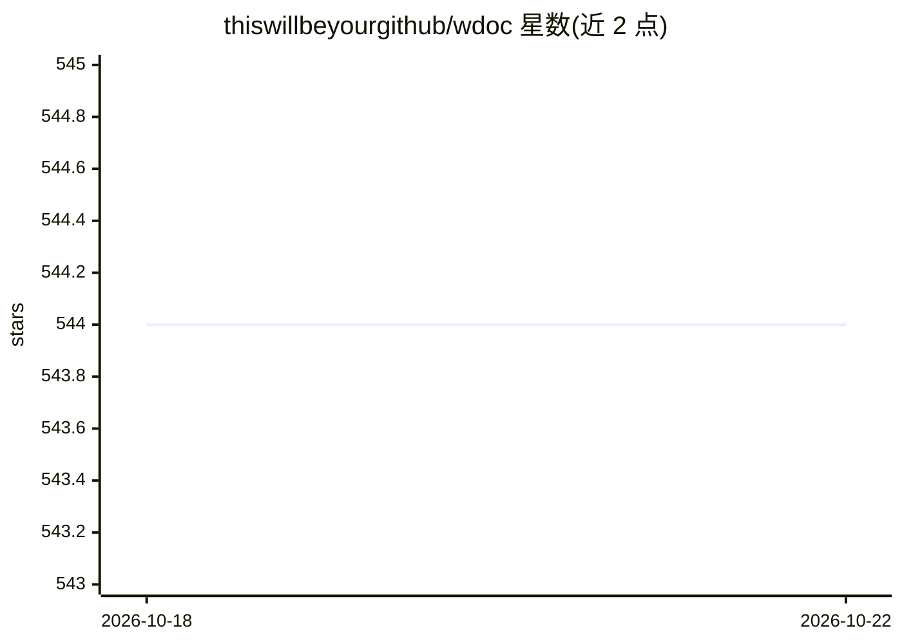

# thiswillbeyourgithub/wdoc

⭐ 544 · Python · AGPL-3.0 · 推送 2026-10-12 · [GitHub](https://github.com/thiswillbeyourgithub/wdoc) · [官网](https://wdoc.readthedocs.io/en/stable/) · 个人维护

**对海量异构文档做检索问答与摘要的 RAG 工具**

面向研究者、学生与专业人士的 RAG 系统：可同时解析 15+ 种文件格式（PDF/EPUB/音频/视频/Anki/YouTube 等）并建索引，通过嵌入检索配合双模型流水线（改写查询、弱模型筛选、强模型逐文档作答、语义聚类合并）输出带来源哈希的 Markdown 回答；另提供递归摘要、网页搜索、私有模式（不出本机）等能力。基于 LangChain 与 LiteLLM 后端，支持任意 LLM 提供商含本地模型。以 uvx/pip 安装的 CLI 与 Python 库形式提供，另有 Gradio Docker Web UI。仍处于活跃开发期，功能持续变动。

## 筛选速览

| 维度 | 判定 | 备注 |
|---|---|---|
| AI 角色 | `ai-native` | 本体是模型或模型工具 |
| 许可风险 | `viral` | AGPL-3.0 |
| 部署形态 | `library` | 以包/库形式分发 |
| 模型依赖 | local-ok | 支持本地模型 |
| 硬件要求 | — | 无带数字的原话,不猜 |
| 安装摩擦 | `high` | 编译与系统依赖俱全 |
| 成熟度 | `idea` | |

## 能力要点

- 15+ 文件类型可组合进同一索引并同时检索
- 多阶段查询流水线（改写-评估-作答-语义聚类合并）且回答带来源哈希
- 私有模式：禁用 API key、隔离缓存、拦截外连
- 递归摘要与 DuckDuckGo 网页搜索

## 适用场景

- 对大量 PDF、讲义、音频等混合资料提问并获得可溯源回答
- 对整本书或长文档生成保留论证脉络的递归摘要
- 在不出本机的私有模式下用本地模型查自己的资料库

## 场景标签

 · 领域:LLM 基础设施/RAG 工具

## 证据(README 行号)

> L9: `wdoc` is a powerful RAG (Retrieval-Augmented Generation) system designed to summarize, search, and query documents 
> L31:  * **Actually *useful* AI powered queries**: get the **sourced** indented markdown answer to your questions instead
> L107:  5. Each document is identified by a unique hash and the answers are sourced, meaning you know from which document

## 星数曲线

2026-10-18 544 → 2026-10-22 544（+0）

---
*卡片 v1 · prompt 1.4 · 生成 2026-10-21 · 置信度 high · 依据 README sha `767237be9142` · [字段定义](../../DATASET.md)*
