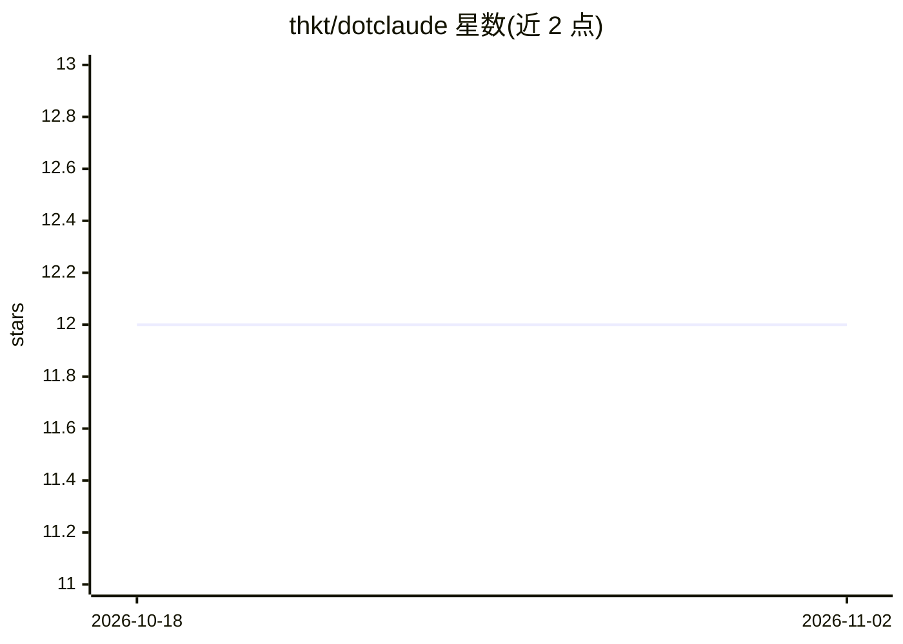

# thkt/dotclaude

⭐ 12 · TypeScript · MIT · 推送 2026-11-01 · [GitHub](https://github.com/thkt/dotclaude) · 个人维护

**个人 Claude Code 配置集：27 技能、28 代理与质量门禁钩子**

面向 Claude Code 的个人 dotfiles 式配置仓库：包含 27 个 slash 命令技能、28 个专用代理（代码评审/生成/分析）、确定性多代理 build 工作流（Load→Verify→Ship 后生成草稿 PR），以及挂在 settings.json 上的质量管线钩子（lint、自动格式化、质量门禁）。可经 Claude Code 插件市场按 build 命名空间安装，或整体克隆为 ~/.claude；沙箱与钩子工具（jq、brew 工具链）为可选推荐项。内部英文处理，用户输出日文可配置，双语文档。

## 筛选速览

| 维度 | 判定 | 备注 |
|---|---|---|
| AI 角色 | `ai-ecosystem` | LLM/agent 周边工具 |
| 许可风险 | `permissive` | MIT |
| 部署形态 | `library` | 以包/库形式分发 |
| 模型依赖 | locked-api |  |
| 硬件要求 | — | 无带数字的原话,不猜 |
| 安装摩擦 | `low` | 无编译、无系统依赖或容器化 |
| 成熟度 | — | 结构信号不足 |

## 能力要点

- 27 个技能命令 + 28 个专用代理（评审/生成/分析）
- 确定性 build 工作流：从 /issue 到草稿 PR 的多阶段管线
- 质量管线钩子：PreToolUse lint/安全检查、PostToolUse 格式化与质量门禁
- 支持 Claude Code 插件市场安装（/plugin install build）或手动克隆全量配置

## 适用场景

- 通过技能与代理组合执行研究→规划→编码→审计的开发流程
- 在 Claude Code 会话中自动拦截 lint 错误并强制质量门禁
- 以 /goal 包裹 /code 实现多轮自主迭代直至条件满足

## 场景标签

`编码 Agent` `代码审查` · 领域:编码与开发

## 证据(README 行号)

> L12: - Custom slash commands for systematic development workflows (27 skills)
> L13: - Specialized AI agents for code review, generation, and analysis (28 agents)
> L32: This repository is available as a Claude Code plugin, allowing you to easily

## 星数曲线

2026-10-18 12 → 2026-11-02 12（+0）

---
*卡片 v1 · prompt 1.4 · 生成 2026-10-31 · 置信度 mid · 依据 README sha `502dec989a5d` · [字段定义](../../DATASET.md)*
