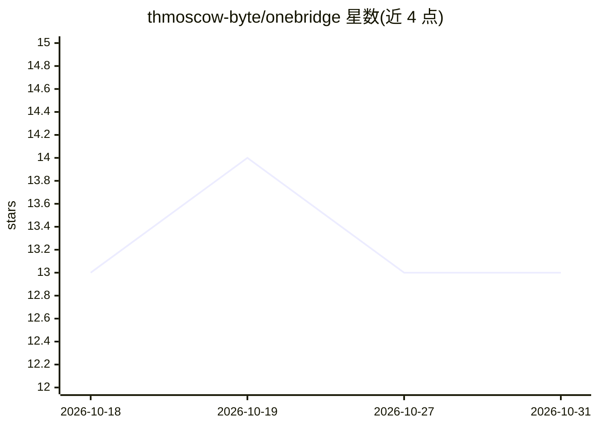

# thmoscow-byte/onebridge

⭐ 13 · MIT · 推送 2026-04-27 · [GitHub](https://github.com/thmoscow-byte/onebridge) · [官网](https://onemanproduction.ru/onebridge/) · 个人维护

**连接 Claude 与 1С:Предприятие 的 MCP 服务器**

以 1С 外部处理（EPF）形式运行的 MCP 服务器：在 1С 内启动 HTTP 服务器（默认端口 1414，SSE + JSON-RPC 2.0），向 Claude Code/Desktop/API 暴露 8 个工具，包括执行 1С 查询、运行服务器端 1С 代码、读取元数据结构、查询事件日志、按导航链接查找对象与检查访问权限。兼容任意 1С 配置（БП、ЗУП、УТ、ERP、УНФ、КА 等）。基于 ROCTUP 的 1c-mcp-toolkit 开发，需 1С 8.3.20+ 与 Windows。通过 Telegram 机器人或 GitHub Releases 分发 EPF 文件。

## 筛选速览

| 维度 | 判定 | 备注 |
|---|---|---|
| AI 角色 | `ai-ecosystem` | LLM/agent 周边工具 |
| 许可风险 | `permissive` | MIT |
| 部署形态 | `None` |  |
| 模型依赖 | locked-api |  |
| 硬件要求 | — | 无带数字的原话,不猜 |
| 安装摩擦 | `low` | 无编译、无系统依赖或容器化 |
| 成熟度 | — | 结构信号不足 |

## 能力要点

- 提供 execute_query / execute_code 等 8 个 MCP 工具操作 1С 数据库
- 以 EPF 形式在 1С 内运行，通过 SSE + JSON-RPC 2.0 对接 MCP 客户端
- 兼容任意 1С 配置（БП/ЗУП/УТ/ERP/УНФ/КА 等）
- 读取元数据结构（目录、文档、寄存器）供 AI 生成配置感知代码

## 适用场景

- 让 Claude 直接查询我的 1С 数据库结构和数据
- 用自然语言让 AI 编写处理 1С 文档的代码
- 通过 AI 检查 1С 事件日志和访问权限

## 场景标签

`数据分析` · 领域:效率与自动化

## 证据(README 行号)

> L5: **OneBridge** подключает Claude (Code, Desktop, API) к вашей базе 1С:Предприятие через протокол MCP. AI видит метада
> L97: OneBridge работает как внешняя обработка (EPF) внутри 1С и поднимает HTTP-сервер, совместимый с протоколом MCP. Cla
> L89: ┌──────────────┐     MCP (SSE)      ┌──────────────┐     COM/HTTP     ┌──────────────┐

## 星数曲线

2026-10-18 13 → 2026-10-31 13（+0）

---
*卡片 v1 · prompt 1.4 · 生成 2026-10-31 · 置信度 high · 依据 README sha `caa804b7d3d0` · [字段定义](../../DATASET.md)*
