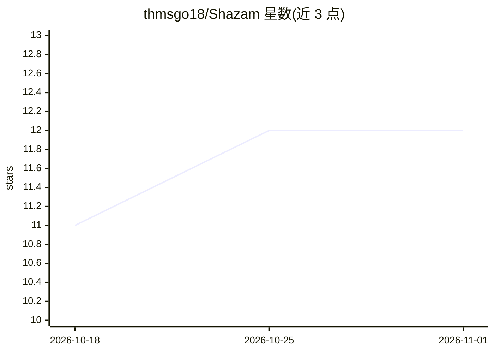

# thmsgo18/Shazam

⭐ 12 · Python · 推送 2026-05-26 · [GitHub](https://github.com/thmsgo18/Shazam) · 个人维护

**Shazam 式音乐识别系统：FAISS 向量检索+频谱指纹**

受 Shazam 启发的音乐识别系统（大数据课程项目），从麦克风录音或上传文件中识别曲库中的匹配曲目并给出流媒体链接。两阶段流水线：第一阶段将 5 秒窗口经预训练模型（MFCC/CLAP/MuQ/MERT 四种可选嵌入方法）转为向量并查询 FAISS 索引取前 50 候选；第二阶段实现 Shazam 专利的频谱峰指纹，与 SQLite 中指纹比对并做时间对齐，最终以指纹分优先、FAISS 分决胜。含 FastAPI 后端与 React 网页界面，支持 RIR 混响增强与推荐。数据来自 Kaggle Spotify 榜单并通过 yt-dlp 从 YouTube 下载音频。限制：需 Python 3.10（3.11+ 不支持）、ffmpeg；MuQ 嵌入需 NVIDIA GPU。

## 筛选速览

| 维度 | 判定 | 备注 |
|---|---|---|
| AI 角色 | `ai-native` | 本体是模型或模型工具 |
| 许可风险 | `none` | — |
| 部署形态 | `library` | 以包/库形式分发 |
| 模型依赖 | — | README 未给出锁定关系 |
| 硬件要求 | — | 无带数字的原话,不猜 |
| 安装摩擦 | `medium` | 含编译或系统依赖之一 |
| 成熟度 | — | 结构信号不足 |

## 能力要点

- 两阶段识别：CLAP/MuQ/MERT/MFCC 嵌入 FAISS 检索 + Shazam 专利式频谱指纹时间对齐
- 四种可共存嵌入方法，增量计算已存曲目不需重新下载
- RIR 房间混响增强（10 种合成环境 + MIT 实测 RIR）提升噪声/混响鲁棒性
- FastAPI + React 网页界面：麦克风录音、文件上传、结果流媒体链接与相似曲目推荐

## 适用场景

- 我录一段环境音，想知道正在放的是什么歌并跳转流媒体
- 在噪声或混响环境下识别短音频片段中的曲目
- 对比不同嵌入方法与指纹策略在音乐检索上的表现

## 场景标签

 · 领域:音频/音乐信息检索

## 证据(README 行号)

> L19: A music recognition system inspired by Shazam, developed as part of a Big Data project (Master IAD, S2). Given an a
> L21: The approach combines the power of deep learning embeddings (FAISS vector search) with spectral fingerprinting insp

## 星数曲线

2026-10-18 11 → 2026-11-01 12（+1）

---
*卡片 v1 · prompt 1.4 · 生成 2026-10-31 · 置信度 mid · 依据 README sha `8aaee75611bc` · [字段定义](../../DATASET.md)*
