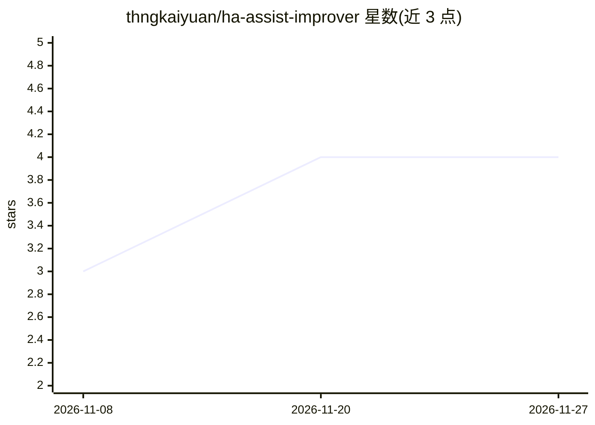

# thngkaiyuan/ha-assist-improver

⭐ 4 · Python · Apache-2.0 · 推送 2026-11-26 · [GitHub](https://github.com/thngkaiyuan/ha-assist-improver) · 个人维护

**从 Assist 对话中学习并提议经测试的改进的 Home Assistant 集成**

作为 Home Assistant 自定义集成运行：留存你的 Assist 对话及结果，由深度思考模型分析你在哪些环节不得不干预（目标未达成、重复/纠正/澄清的多余轮次），提出改进提案；每条提案先在沙箱化的 Home Assistant 副本上重放相同对话做反事实测试，只有证明省力的改动才提交给你审批。数据保存在本地 Home Assistant 中，卸载后已接受的改进保留。当前为早期版本，作者在自家环境中日常使用。

## 筛选速览

| 维度 | 判定 | 备注 |
|---|---|---|
| AI 角色 | `ai-native` | 本体是模型或模型工具 |
| 许可风险 | `permissive` | Apache-2.0 |
| 部署形态 | `None` |  |
| 模型依赖 | locked-api |  |
| 硬件要求 | — | 无带数字的原话,不猜 |
| 安装摩擦 | `low` | 无编译、无系统依赖或容器化 |
| 成熟度 | `idea` | |

## 能力要点

- 对话留存于本地 Home Assistant，沙箱重放测试提案（仅模拟设备，不动真实家居）
- 四步流水线：学习→分析→测试→用户审批，每步可配置模型
- 测过 Anthropic 与 OpenRouter，其他 AI 供应商声明也应可用
- 经审批的改进在卸载集成后仍然保留

## 适用场景

- 对话没达到预期时让 Assist 提交一条改进
- 批量回放过去不顺利的对话生成改进提案
- 设置定时任务自动把所有对话送入改进流水线

## 场景标签

 · 领域:智能家居/语音助手优化

## 证据(README 行号)

> L24: Assist Improver aims for that with your assistant. The goal is to cut the effort it takes you to get what you wante
> L28: 3. **Tests.** Replays the same conversations with each change, as a counterfactual experiment, on your own assistan

## 星数曲线

2026-11-08 3 → 2026-11-27 4（+1）

---
*卡片 v1 · prompt 1.4 · 生成 2026-11-21 · 置信度 high · 依据 README sha `fc88bcbda884` · [字段定义](../../DATASET.md)*
