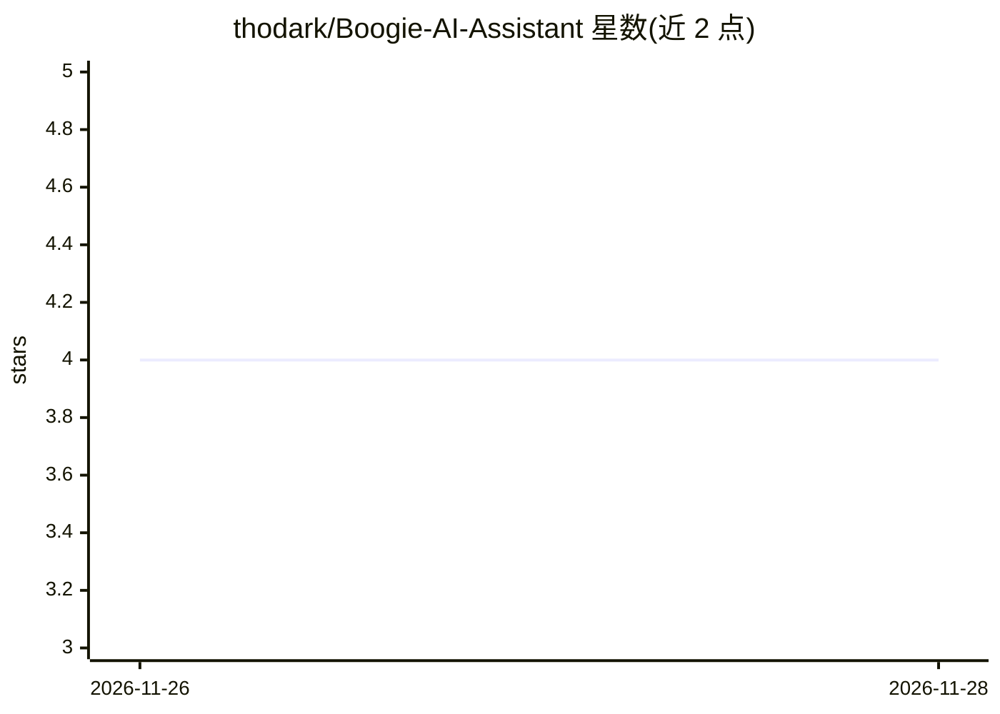

# thodark/Boogie-AI-Assistant

⭐ 4 · Rust · MIT · 推送 2026-11-25 · [GitHub](https://github.com/thodark/Boogie-AI-Assistant) · [官网](https://thodark.github.io/Boogie-AI-Assistant/) · 个人维护 · 中文 README

**面向 Windows 用户的 Rust 原生实时语音 AI 桌面助手**

以纯 Rust 编写的单文件 Windows 语音助手：通过持久 TLS WebSocket 将 16 kHz WASAPI 麦克风音频直接流式传输到 Gemini Live API，避免独立的 STT→LLM→TTS 链路，用 OpenGL GLSL 渲染音频响应式 3D 玻璃球界面。功能覆盖 Study Visual 教学板、文档生成（PDF/Word/Excel，无需 Office）、46 个原生 Windows 工具（应用启动、浏览器自动化、屏幕视觉、系统控制）、持久记忆及本地 API key 存储。提供确认门、提示注入防御、SSRF 防护等安全机制。支持英语与越南语。

## 筛选速览

| 维度 | 判定 | 备注 |
|---|---|---|
| AI 角色 | `ai-native` | 本体是模型或模型工具 |
| 许可风险 | `permissive` | MIT |
| 部署形态 | `desktop` | 安装包/桌面程序 |
| 模型依赖 | — | README 未给出锁定关系 |
| 硬件要求 | — | 无带数字的原话,不猜 |
| 安装摩擦 | `medium` | 含编译或系统依赖之一 |
| 成熟度 | — | 结构信号不足 |

## 能力要点

- 音频直接流式到 Gemini Live，~580 ms 首音频延迟，< 20 ms barge-in 打断
- 46 个原生 Windows 工具：应用启动、浏览器自动化、屏幕视觉、可撤销 undo
- Document Studio 生成 PDF/Word/Excel 学习资料与试题，无需 Microsoft Office
- 安全机制：Save As 原生对话框、破坏性操作确认门、提示注入标记与 SSRF 防护

## 适用场景

- 通过语音命令控制桌面应用、系统设置与浏览器自动化
- 对屏幕上的题目拍照求解并生成逐步教学板讲解
- 生成带答案键的练习试卷、学习指南与公式化 Excel 表格
- 作为 JARVIS 式语音助手管理提醒、媒体与长期记忆

## 场景标签

`语音 Agent` `AI 助手` `浏览器自动化` · 领域:效率与自动化

## 证据(README 行号)

> L5: **Native Rust real-time voice AI assistant & desktop agent for Windows.**
> L29: Boogie is a single-binary Windows voice assistant written from scratch in **pure Rust**. Instead of bundling Electr
> L37: |**46 Native Windows Tools**|App launcher (Win32 / Start Menu / Registry), real browser automation, screen vision, 

## 星数曲线

2026-11-26 4 → 2026-11-28 4（+0）

---
*卡片 v1 · prompt 1.4 · 生成 2026-11-26 · 置信度 high · 依据 README sha `ef56cf2dbbad` · [字段定义](../../DATASET.md)*
