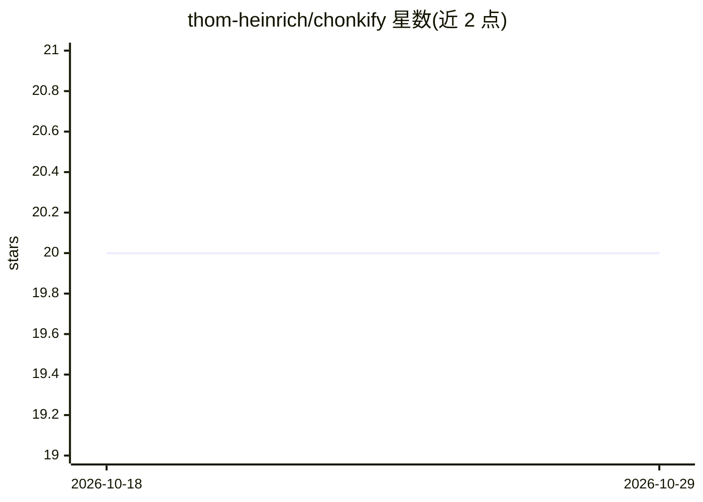

# thom-heinrich/chonkify

⭐ 20 · Python · NOASSERTION · 推送 2026-03-26 · [GitHub](https://github.com/thom-heinrich/chonkify) · 个人维护

**面向 RAG 与 agent 管线的抽取式文档压缩工具**

以信息恢复为目标的抽取式长文档压缩库：构建忠实于原文的文档单元，经 768 维嵌入接口打分，在给定 token 预算内输出压缩结果，并生成含压缩率与所选来源块的 JSON 元数据。提供 CLI 与 Python API，嵌入后端支持 Azure OpenAI（默认）、OpenAI、OpenAI 兼容端点及本地 SentenceTransformers（可离线、支持 cpu/cuda/mps）。以 cp311 编译 wheel 分发；当前许可声明仅限评估、测试与评审用途，不可用于生产。

## 筛选速览

| 维度 | 判定 | 备注 |
|---|---|---|
| AI 角色 | `ai-ecosystem` | LLM/agent 周边工具 |
| 许可风险 | `none` | NOASSERTION |
| 部署形态 | `library` | 以包/库形式分发 |
| 模型依赖 | locked-api |  |
| 硬件要求 | — | 无带数字的原话,不猜 |
| 安装摩擦 | `medium` | 含编译或系统依赖之一 |
| 成熟度 | — | 结构信号不足 |

## 能力要点

- 构建文档单元并经 768 维嵌入打分，在 token 预算内输出压缩结果
- 四种嵌入后端：Azure OpenAI / OpenAI / OpenAI 兼容端点 / 本地 SentenceTransformers
- 提供 CLI（含多文档与 stdin 管道）与 Python API，输出压缩元数据 JSON
- 以 cp311 编译 wheel 分发，性能敏感部分为编译扩展模块

## 适用场景

- 在 token 预算内压缩 RAG 检索文档与 agent 记忆
- 压缩含量化事实/推理链的文本以保留下游模型所需精确信息
- 配合本地嵌入模型做离线/内网的文档压缩

## 场景标签

`RAG` `Agent 记忆` · 领域:Agent 开发

## 证据(README 行号)

> L5: chonkify compresses long documents into tight, information-dense context for RAG pipelines, agent memory, and any wo
> L13: Most compression tools optimize for token reduction. chonkify optimizes for **information recovery** — the compress

## 星数曲线

2026-10-18 20 → 2026-10-29 20（+0）

---
*卡片 v1 · prompt 1.4 · 生成 2026-10-28 · 置信度 high · 依据 README sha `1b35100856a4` · [字段定义](../../DATASET.md)*
