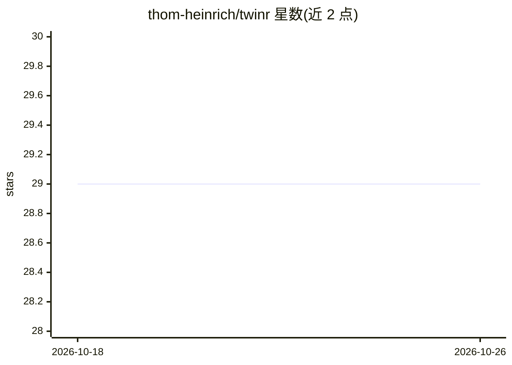

# thom-heinrich/twinr

⭐ 29 · Python · MIT · 推送 2026-04-15 · [GitHub](https://github.com/thom-heinrich/twinr) · [官网](https://twinr.com) · 个人维护

**面向老年人的实体 AI 语音陪伴设备（树莓派硬件项目）**

开源的实体 AI Agent 项目，目标是让不熟悉数字产品的老年人通过语音和实体按钮使用 AI：包含语音问答（web 支持）、热敏打印机纸质输出、HDMI 表情界面、AI 摄像头的人/手势/在场感知、提醒与记忆栈、自动化例程、照护者仪表盘，以及 WhatsApp 原型通道。运行于 Raspberry Pi 4 及以上，需自行组装硬件（麦克风阵列、PIR、热敏打印机、可选舵机）并按接线文档配置 GPIO。README 自述处于重度 WIP 状态，需动手调试方可运行。

## 筛选速览

| 维度 | 判定 | 备注 |
|---|---|---|
| AI 角色 | `ai-native` | 本体是模型或模型工具 |
| 许可风险 | `permissive` | MIT |
| 部署形态 | `None` |  |
| 模型依赖 | — | README 未给出锁定关系 |
| 硬件要求 | — | 无带数字的原话,不猜 |
| 安装摩擦 | `low` | 无编译、无系统依赖或容器化 |
| 成熟度 | `idea` | |

## 能力要点

- 语音优先管线 + 物理按钮 + 热敏打印机纸质输出 + HDMI 表情 UI 的多模态交互
- 基于传感器融合的在场/注意力/事件提示与主动陪伴行为
- 自适应记忆栈与自动化引擎（定时例程、LLM 生成周期任务）
- 照护者/操作员仪表盘与 3D 打印外壳文件随仓库提供

## 适用场景

- 为不使用智能手机/电脑的长辈提供语音问答与提醒陪伴设备
- 通过热敏打印机以纸质形式输出笔记与简报
- 照护者通过仪表盘远程查看设备状态与记忆/自动化配置

## 场景标签

 · 领域:硬件/具身 AI 陪伴设备

## 证据(README 行号)

> L3: *TWINR* is an AI Agent for senior citizens; fully open-source, aiming to make AI accessible to people who would real
> L24: Twinr is not just a voice wrapper. This repo spans embodied interaction, multimodal perception, memory, automations
> L27: - Transcript-first live voice pipeline with follow-up listening, spoken replies, and web-backed question answering

## 星数曲线

2026-10-18 29 → 2026-10-26 29（+0）

---
*卡片 v1 · prompt 1.4 · 生成 2026-10-26 · 置信度 high · 依据 README sha `35d90cad1c5a` · [字段定义](../../DATASET.md)*
