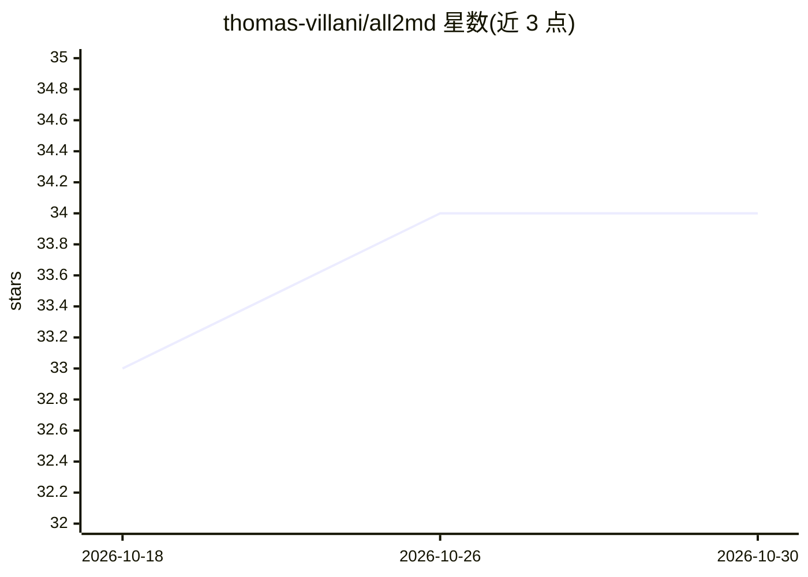

# thomas-villani/all2md

⭐ 34 · Python · MIT · 推送 2026-10-28 · [GitHub](https://github.com/thomas-villani/all2md) · [官网](https://all2md.readthedocs.io/) · 个人维护

**开发者工具：40+ 格式与 Markdown 双向转换、检索与分块，供 LLM/RAG 流水线用**

Python 库 + CLI + MCP 服务器三形态的文档转换工具：将 PDF、Office、电子书、邮件、归档等 40+ 格式转为 Markdown 并可反向渲染；附终端阅读器 rcat、跨格式 grep/BM25/混合搜索、面向 RAG 的 11 种分块策略（保留节标题与页码溯源），以及内置 MCP 服务器让 Claude 等 AI 助手直接读取/编辑文档。核心零依赖，各格式按 extra 拉取依赖；提供基于公开基准的转换保真度度量与 GitHub Action 质量门禁。OCR 与向量/混合搜索需额外 extra。

## 筛选速览

| 维度 | 判定 | 备注 |
|---|---|---|
| AI 角色 | `ai-ecosystem` | LLM/agent 周边工具 |
| 许可风险 | `permissive` | MIT |
| 部署形态 | `library` | 以包/库形式分发 |
| 模型依赖 | — | README 未给出锁定关系 |
| 硬件要求 | — | 无带数字的原话,不猜 |
| 安装摩擦 | `low` | 无编译、无系统依赖或容器化 |
| 成熟度 | — | 结构信号不足 |

## 能力要点

- 40+ 输入格式与 Markdown 双向转换，含 OCR 扫描页路径
- 11 种分块策略，chunk 携带节标题与页码，输出 JSONL 供向量库使用
- 内置 MCP 服务器（含 Claude Desktop 一键扩展），助手可读写/搜索/比对文档
- 转换保真度对 PubMed Central/OmniDocBench 等公开基准度量，附 CI 质量门禁

## 适用场景

- 把一批 PDF/Word/邮件批量转成 Markdown 喂给 RAG 或 LLM 流水线
- 让 Claude 等 AI 助手通过 MCP 直接读取和编辑我的文档
- 在终端阅读或跨格式 grep 检索 PDF/Office 文件
- 用 CI 门禁守住文档转换质量

## 场景标签

`文档解析` `OCR` `语义搜索` · 领域:知识与检索

## 证据(README 行号)

> L5: **Read, convert, search, and chunk PDFs, Office files, e-books, emails, and 40+ other formats, as Markdown and back 
> L60: |Feed documents to a RAG pipeline|`all2md chunk handbook.pdf`|RAG and chunking|
> L153: all2md ships a Model Context Protocol server, so an assistant like Claude can read your PDFs and Office files, wri

## 星数曲线

2026-10-18 33 → 2026-10-30 34（+1）

---
*卡片 v1 · prompt 1.4 · 生成 2026-10-25 · 置信度 high · 依据 README sha `9ec79ea5caf2` · [字段定义](../../DATASET.md)*
