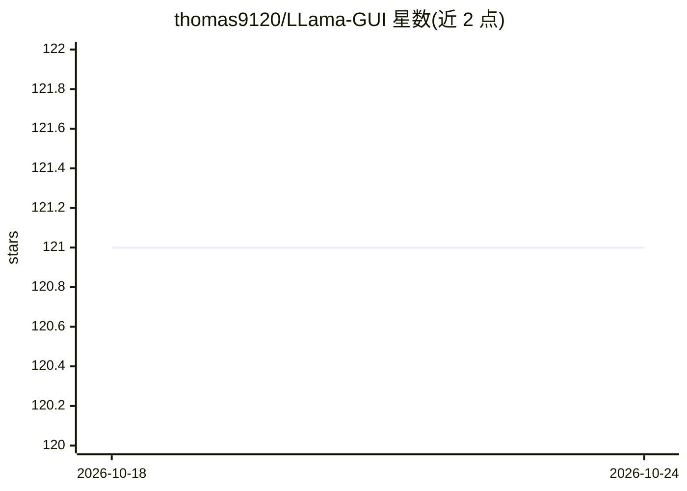

# thomas9120/LLama-GUI

⭐ 121 · JavaScript · GPL-3.0 · 推送 2026-10-20 · [GitHub](https://github.com/thomas9120/LLama-GUI) · 个人维护

**给本地 llama.cpp 用户的浏览器图形启动器与控制面板**

面向本地运行 llama.cpp 的用户：以浏览器 UI 安装预构建的 llama.cpp 后端（CPU/CUDA/Vulkan/SYCL/ROCm 等），通过 Quick Launch 或完整 Configure 启动 llama-server/llama-cli，提供流式 Markdown 聊天、llama-bench/perplexity 基准测试、实时系统与 GPU 监控、预设管理与 OpenAI 兼容 API 片段。支持在应用内按 Hugging Face repo ID 下载 GGUF 模型。默认仅监听 127.0.0.1:5240 且无内置鉴权，公开暴露需反向代理。需 Python 3.9+，跨 Windows/macOS/Linux。

## 筛选速览

| 维度 | 判定 | 备注 |
|---|---|---|
| AI 角色 | `ai-ecosystem` | LLM/agent 周边工具 |
| 许可风险 | `viral` | GPL-3.0 |
| 部署形态 | `library` | 以包/库形式分发 |
| 模型依赖 | local-ok | 支持本地模型 |
| 硬件要求 | — | 无带数字的原话,不猜 |
| 安装摩擦 | `medium` | 含编译或系统依赖之一 |
| 成熟度 | — | 结构信号不足 |

## 能力要点

- 按后端一键安装预构建 llama.cpp 二进制（CPU/CUDA/Vulkan/SYCL/ROCm/Metal）
- Quick Launch 入门启动与完整参数 Configure 双模式，命令预览
- 内置聊天（流式 Markdown/聚焦模式/可选联网搜索）与 OpenAI 兼容 API 片段
- llama-bench / llama-perplexity 基准测试与 CPU/RAM/GPU 实时监控

## 适用场景

- 不熟悉命令行时在本地启动和管理 llama.cpp 推理服务
- 在应用内下载 GGUF 模型并快速切换服务预设
- 对本地模型跑吞吐与困惑度基准测试

## 场景标签

`推理引擎` `模型评测` · 领域:评测与运维

## 证据(README 行号)

> L11: Lightweight local launcher and control panel for `llama.cpp` on Windows, macOS, and Linux.
> L15: - launch `llama-server` or `llama-cli` from beginner **Quick Launch** or full **Configure**

## 星数曲线

2026-10-18 121 → 2026-10-24 121（+0）

---
*卡片 v1 · prompt 1.4 · 生成 2026-10-23 · 置信度 mid · 依据 README sha `e076befe3985` · [字段定义](../../DATASET.md)*
