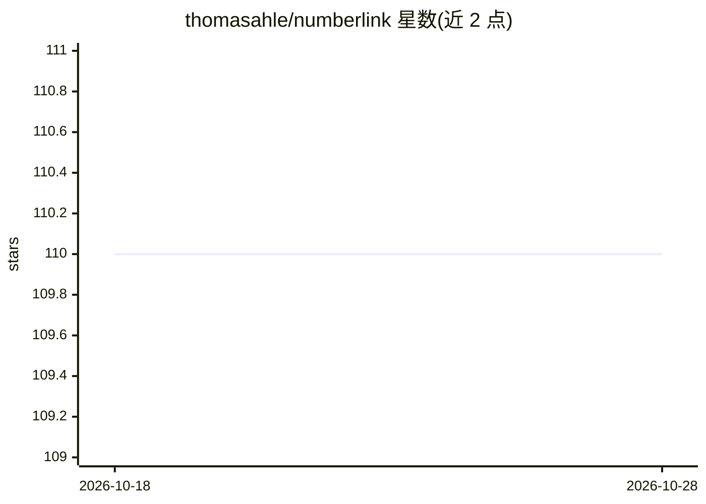

# thomasahle/numberlink

⭐ 110 · Go · AGPL-3.0 · 推送 2026-01-26 · [GitHub](https://github.com/thomasahle/numberlink) · 个人维护

**生成与求解 Numberlink/Flow Free 谜题的命令行程序**

由 Thomas Dybdahl Ahle 编写的 Numberlink（Arukone/Flow Free）谜题求解与生成程序：Go 编写的求解器从标准输入读取谜题并输出解答或 IMPOSSIBLE，采用按对角线系统填充的重度剪枝回溯搜索（部分链、corner dual 表示、乐观验证），可处理 40x40 规模实例；另附 Python 脚本 gen.py 生成大尺寸谜题，可控制数字对数量。程序假定谜题唯一解，不能用于验证解的唯一性。

## 筛选速览

| 维度 | 判定 | 备注 |
|---|---|---|
| AI 角色 | `ai-enhanced` | 去掉 AI 部分产品仍成立 |
| 许可风险 | `viral` | AGPL-3.0 |
| 部署形态 | `library` | 以包/库形式分发 |
| 模型依赖 | — | README 未给出锁定关系 |
| 硬件要求 | — | 无带数字的原话,不猜 |
| 安装摩擦 | `low` | 无编译、无系统依赖或容器化 |
| 成熟度 | — | 结构信号不足 |

## 能力要点

- Go 求解器从 stdin 读取谜题并输出解答
- 重度剪枝回溯（部分链、corner dual、乐观验证）求解 40x40 实例
- Python 脚本生成大尺寸谜题，可配置数字对数量
- 遵循 Affero GPL3，要求生成的谜题注明出处

## 适用场景

- 求解或生成大尺寸 Numberlink/Flow Free 谜题
- 批量处理 Janko.at 等谜题集
- 为网站或书籍生成可发布的谜题

## 场景标签

 · 领域:算法工具/谜题

## 证据(README 行号)

> L3: Numberlink is a very fast program for generating and solving large instances of the puzzle Numberlink / Arukone / Na
> L14: The python code in `gen/gen.py` can be used to generate very large puzzles. To create such puzzles, simply run the 
> L39:  $ go install github.com/thomasahle/numberlink@latest

## 星数曲线

2026-10-18 110 → 2026-10-28 110（+0）

---
*卡片 v1 · prompt 1.4 · 生成 2026-10-23 · 置信度 mid · 依据 README sha `d1036113f8eb` · [字段定义](../../DATASET.md)*
