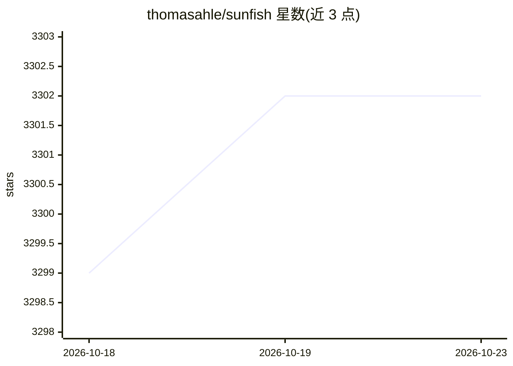

# thomasahle/sunfish

⭐ 3,302 · Python · NOASSERTION · 推送 2026-08-27 · [GitHub](https://github.com/thomasahle/sunfish) · [官网](https://www.chessprogramming.org/Sunfish) · 个人维护

**用约 126 行 Python 实现的极简国际象棋引擎**

以 MTD-bi 搜索与棋子位置表评估为核心的国际象棋引擎，纯 Python 编写、去除注释后仅 126 行，提供 UCI 接口，可接入 Arena、Cute Chess 等 GUI 与对局工具，或 pip 安装后在终端对弈。另有 NNUE 变体 nnue_4k，将累加器与评估头打包进单个 Python 整数，标称快棋下较经典版约 +200 Elo，量化网络经认证后才对局。引擎支持全部国际象棋规则（50 步和棋规则除外），适合实验与二次开发。

## 筛选速览

| 维度 | 判定 | 备注 |
|---|---|---|
| AI 角色 | `ai-native` | 本体是模型或模型工具 |
| 许可风险 | `none` | NOASSERTION |
| 部署形态 | `library` | 以包/库形式分发 |
| 模型依赖 | — | README 未给出锁定关系 |
| 硬件要求 | — | 无带数字的原话,不猜 |
| 安装摩擦 | `low` | 无编译、无系统依赖或容器化 |
| 成熟度 | — | 结构信号不足 |

## 能力要点

- 126 行 Python 实现，采用 MTD-bi 搜索与棋子位置表评估
- 提供 UCI 接口，可接入各类 GUI 与命令行对局工具
- nnue_4k 变体将 NNUE 累加器与评估头打包进单个 Python 整数
- 可打包为约 3KB 的自解压可执行文件（TCEC 4k 规则）

## 适用场景

- 在终端或 Lichess 上与引擎对弈
- 作为实验平台研究搜索算法、评估函数与深度学习棋类程序
- 通过 UCI 接入 GUI 或棋类对局/测试工具

## 场景标签

 · 领域:游戏 AI/棋类引擎

## 证据(README 行号)

> L3: Sunfish is a simple, but strong chess engine, written in Python. With its simple
> L73: nnue_4k/ is a sunfish whose evaluation is classic's exact
> L85: 1. Built around the simple, but efficient MTD-bi search algorithm, also known as C*.

## 星数曲线

2026-10-18 3,299 → 2026-10-23 3,302（+3）

---
*卡片 v1 · prompt 1.4 · 生成 2026-10-20 · 置信度 high · 依据 README sha `90aa14941e0f` · [字段定义](../../DATASET.md)*
