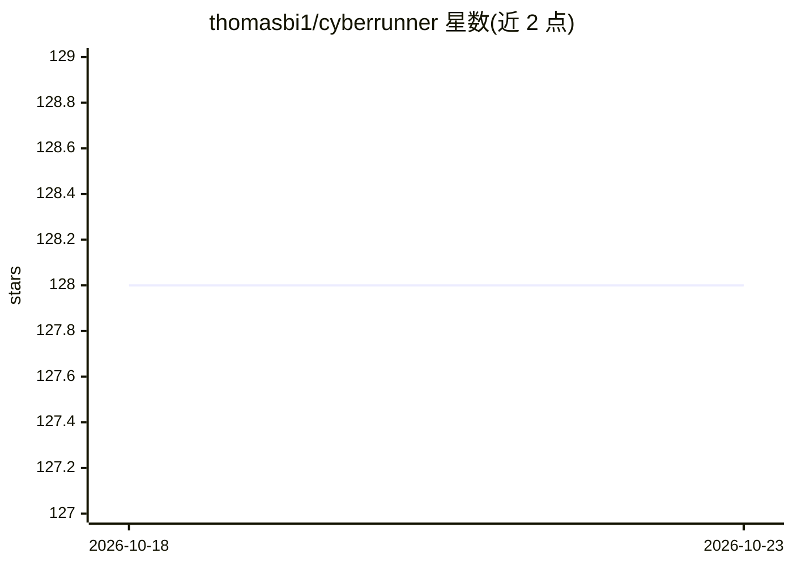

# thomasbi1/cyberrunner

⭐ 128 · Python · AGPL-3.0 · 推送 2026-04-07 · [GitHub](https://github.com/thomasbi1/cyberrunner) · [官网](https://cyberrunner.readthedocs.io/) · 个人维护

**自主学习玩迷宫滚珠游戏的实体 AI 机器人项目**

CyberRunner 是一个 AI 机器人项目：通过相机俯视迷宫盘面采集观测、依据表现获得奖励，使用基于模型的强化学习算法从经验记忆中学习系统行为并规划未来策略，持续改进两个电机的操控以解开迷宫，学习过程与游戏运行并发执行，README 称其 6 小时练习后可超越最佳人类玩家。仓库提供建造该机器人所需的全部代码与文档。附 ICRA 2024 论文引用信息，源码以 AGPL-3.0 发布。属硬件机器人项目，需自建实体装置。

## 筛选速览

| 维度 | 判定 | 备注 |
|---|---|---|
| AI 角色 | `ai-native` | 本体是模型或模型工具 |
| 许可风险 | `viral` | AGPL-3.0 |
| 部署形态 | `None` |  |
| 模型依赖 | — | README 未给出锁定关系 |
| 硬件要求 | — | 无带数字的原话,不猜 |
| 安装摩擦 | `low` | 无编译、无系统依赖或容器化 |
| 成熟度 | — | 结构信号不足 |

## 能力要点

- 基于模型的强化学习，边玩边学、算法与游戏并发运行
- 通过相机观测盘面，控制两个电机操控迷宫
- 提供建造机器人所需的全部代码与文档
- 附 ICRA 2024 论文（数据增强的模型式强化学习）

## 适用场景

- 按文档搭建自己的 CyberRunner 机器人并训练其解迷宫
- 作为实体系统上模型式强化学习的研究与复现项目
- 学术引用与课堂演示样本高效强化学习

## 场景标签

 · 领域:机器人/强化学习研究

## 证据(README 行号)

> L5: CyberRunner is an AI robot whose task is to learn how to play the popular and widely accessible labyrinth marble gam
> L21: CyberRunner exploits recent advances in model-based reinforcement learning and its ability to make informed decisio

## 星数曲线

2026-10-18 128 → 2026-10-23 128（+0）

---
*卡片 v1 · prompt 1.4 · 生成 2026-10-22 · 置信度 high · 依据 README sha `c77bc9ba5824` · [字段定义](../../DATASET.md)*
