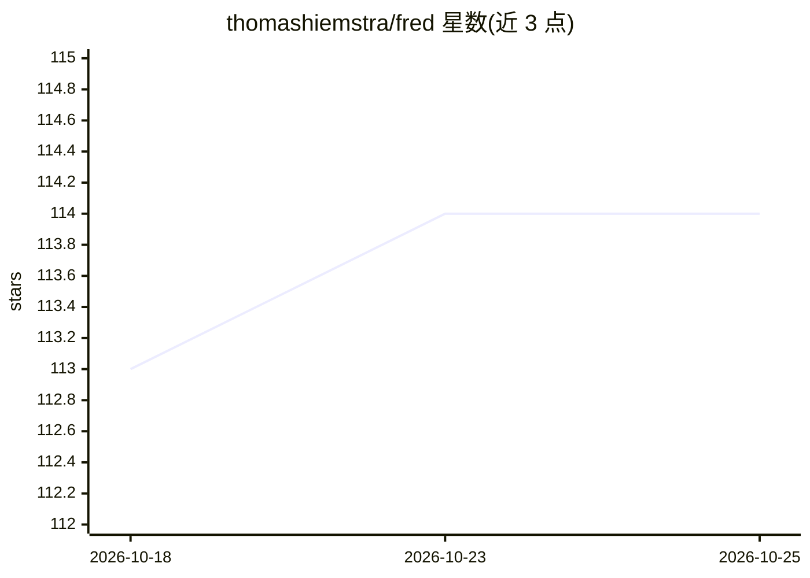

# thomashiemstra/fred

⭐ 114 · Python · GPL-3.0 · 推送 2026-10-23 · [GitHub](https://github.com/thomashiemstra/fred) · 个人维护

**3D 打印机械臂项目：用深度强化学习实现避障运动规划**

个人 3D 打印六轴机械臂项目。核心是深度强化学习避障：将障碍物转为占据网格以卷积网络输入，采用 Soft Actor Critic 算法（TF-Agents 库实现）控制机械臂目标位姿，输出经 B-spline 平滑；替代基于势场梯度下降的经典方法。真实部署用 OpenCV aruco 标记做机器视觉定位障碍物，另含逆运动学实现（基于 Sciavicco & Siciliano 教材）、Xbox 手柄示教、Flask REST 控制面板与 Docker GPU 训练流程。硬件为 Dynamixel 舵机与 Bambu Lab P1S 打印件。

## 筛选速览

| 维度 | 判定 | 备注 |
|---|---|---|
| AI 角色 | `ai-native` | 本体是模型或模型工具 |
| 许可风险 | `viral` | GPL-3.0 |
| 部署形态 | `self-host` | docker 或自建部署 |
| 模型依赖 | — | README 未给出锁定关系 |
| 硬件要求 | — | 无带数字的原话,不猜 |
| 安装摩擦 | `low` | 无编译、无系统依赖或容器化 |
| 成熟度 | — | 结构信号不足 |

## 能力要点

- Soft Actor Critic（TF-Agents）训练避障智能体，占据网格作为卷积输入
- OpenCV aruco 标记实现真实世界障碍物到数字空间的转换
- 提供逆运动学实现（含 ik_documentation.pdf 数学文档）
- Flask REST API 控制面板与 Docker GPU 训练流程

## 适用场景

- 学习强化学习在机械臂避障规划中的应用
- 参考自制 3D 打印机械臂的硬件与逆运动学实现
- 用 aruco 视觉标记做机器人位置追踪与控制

## 场景标签

`强化学习` · 领域:训练与推理

## 证据(README 行号)

> L8: Using deep reinforcement learning the robot can reach the goal whilst avoiding obstacles, it even outperforms a clas
> L37: The specific algorithm used here is the soft actor critic method (Soft Actor Critic__ Haarnoja et al., 2018). For t

## 星数曲线

2026-10-18 113 → 2026-10-25 114（+1）

---
*卡片 v1 · prompt 1.4 · 生成 2026-10-23 · 置信度 high · 依据 README sha `65334df794a0` · [字段定义](../../DATASET.md)*
