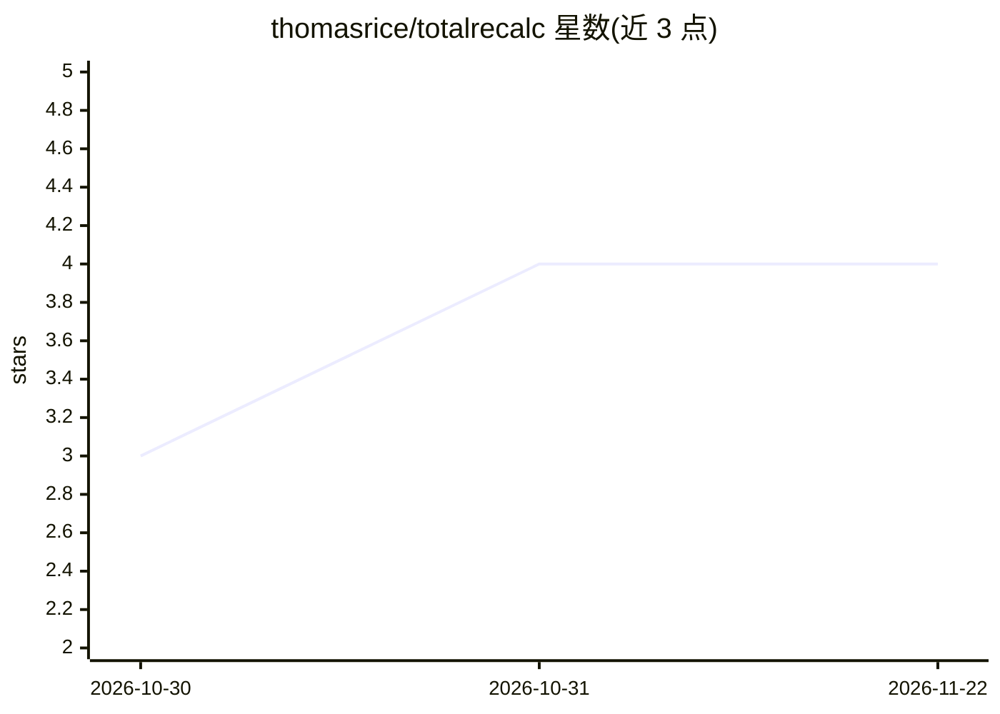

# thomasrice/totalrecalc

⭐ 4 · TypeScript · MIT · 推送 2026-10-28 · [GitHub](https://github.com/thomasrice/totalrecalc) · [官网](https://www.totalrecalc.com/) · 个人维护

**随 AI agent 编辑实时刷新的只读 Excel 查看器**

面向让 AI agent 修改电子表格模型的工作流：以只读方式加载 .xlsx/.xlsm，监控文件变化并在约一秒内刷新，保持光标与滚动位置；通过按行标签对齐新旧版本，将 agent 直接编辑的单元格与由此重算的结果区分显示。内置 IronCalc 引擎重算公式，无法忠实求值时回退到 Excel 保存的结果。提供 Windows/Linux/macOS 安装包，应用无网络请求，仅支持查看，不支持编辑、保存或导出。

## 筛选速览

| 维度 | 判定 | 备注 |
|---|---|---|
| AI 角色 | `ai-enhanced` | 去掉 AI 部分产品仍成立 |
| 许可风险 | `permissive` | MIT |
| 部署形态 | `desktop` | 安装包/桌面程序 |
| 模型依赖 | — | README 未给出锁定关系 |
| 硬件要求 | — | 无带数字的原话,不猜 |
| 安装摩擦 | `medium` | 含编译或系统依赖之一 |
| 成熟度 | `idea` | |

## 能力要点

- 文件变化约一秒内刷新，保持工作表、滚动位置与选中单元格
- 区分 agent 编辑的单元格与重算结果，提供按基线的变更面板
- 内置 IronCalc 引擎重算公式，保留最近 30 个版本内存中比对
- Copy with context 以 Markdown 复制值、公式与前后值供粘贴给 agent

## 适用场景

- 让 Claude Code 等 agent 修改财务模型时实时查看改动
- 区分 agent 的编辑与由此触发的重算结果
- 审查 agent 对大型工作簿的具体改动

## 场景标签

 · 领域:办公工具/电子表格

## 证据(README 行号)

> L4: A fast, read-only viewer for Excel workbooks that refreshes itself the moment the file changes, keeps your place, an
> L20: - **It never touches the file.** It reads the workbook into memory and lets go, so an agent can overwrite, replace 
> L121: Early, and used daily on Linux. Windows builds come from CI. See CHANGELOG.md.

## 星数曲线

2026-10-30 3 → 2026-11-22 4（+1）

---
*卡片 v1 · prompt 1.4 · 生成 2026-11-21 · 置信度 mid · 依据 README sha `70e320a457e8` · [字段定义](../../DATASET.md)*
