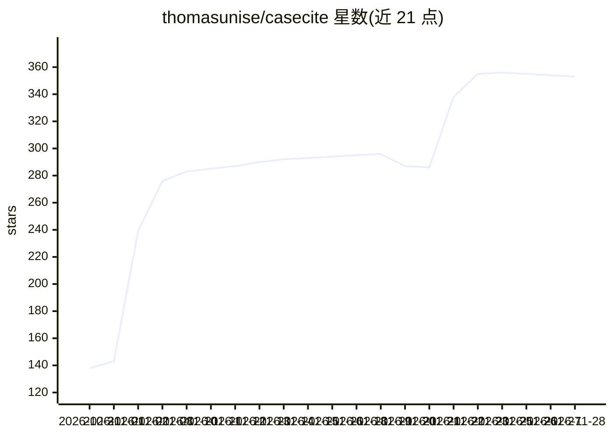

# thomasunise/casecite

⭐ 353 · Python · Apache-2.0 · 推送 2026-11-05 · [GitHub](https://github.com/thomasunise/casecite) · [官网](https://thomasunise.com/casecite) · 个人维护

**自托管法律 RAG 研究与文档分析平台**

CaseCite 是一个开源、自托管的法律研究平台，律所在自有服务器上部署后上传文档，通过混合检索（向量搜索+全文关键词索引+秩融合）对分块语料问答并生成内联引用，每条引用对照原文核验。功能涵盖研究（含可编辑计划的深度研究）、合同审阅与逐条比较、表格化批量审阅、工作流自动化、起草、Matter 工作区、CourtListener 判例与法官分析，另提供 Microsoft Word 加载项。AI 功能采用 BYOK，密钥服务端 AES-256-GCM 加密存储，无遥测；每个 AI 输出附带需人工核验的提示。

## 筛选速览

| 维度 | 判定 | 备注 |
|---|---|---|
| AI 角色 | `ai-native` | 本体是模型或模型工具 |
| 许可风险 | `permissive` | Apache-2.0 |
| 部署形态 | `self-host` | docker 或自建部署 |
| 模型依赖 | — | README 未给出锁定关系 |
| 硬件要求 | — | 无带数字的原话,不猜 |
| 安装摩擦 | `low` | 无编译、无系统依赖或容器化 |
| 成熟度 | — | 结构信号不足 |

## 能力要点

- 混合检索（向量+全文+秩融合）与逐条引用核验的研究问答
- 合同审阅管线：分析、2–4 份合同逐条比较、redline/草稿导出
- 表格化批量审阅：每个值可回溯到支持它的原文段落
- BYOK 密钥服务端 AES-256-GCM 加密，无遥测

## 适用场景

- 在自有服务器上对律所文档做带引用的法律研究问答
- 批量审阅合同并逐项提取字段导出 Excel
- 将审阅/研究/起草流程编排为后台工作流任务
- 通过 Word 加载项在文档中分析并插入修订建议

## 场景标签

`RAG` `文档问答` `工作流自动化` `科研工具` · 领域:效率与自动化

## 证据(README 行号)

> L7: CaseCite is an **open-source, self-hosted** legal research platform. Upload your firm's documents, ask questions, an
> L15: |**Research** (`/research`)|Chat over your firm's documents — hybrid retrieval (vector search and a full-corpus key

## 星数曲线

2026-10-31 138 → 2026-11-28 353（+215）

---
*卡片 v1 · prompt 1.4 · 生成 2026-11-25 · 置信度 high · 依据 README sha `6ac3b4f9d515` · [字段定义](../../DATASET.md)*
