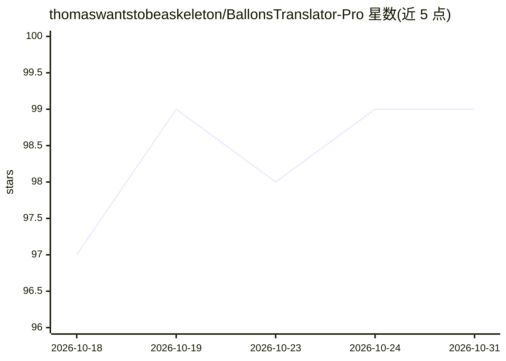

# thomaswantstobeaskeleton/BallonsTranslator-Pro

⭐ 99 · Python · GPL-3.0 · 推送 2026-07-31 · [GitHub](https://github.com/thomaswantstobeaskeleton/BallonsTranslator-Pro) · 个人维护 · 中文 README

**面向漫画汉化/翻译工作流的 AI 辅助翻译工具（BallonsTranslator 分支）**

基于 dmMaze/BallonsTranslator 的漫画/网漫翻译工具分支，整合 90+ 模块：20+ 文本检测器、30+ OCR 引擎、25+ 翻译器、15+ 图像修复器，可混搭组成一键翻译流水线。新增生产级排版工具（自动布局、溢出检查、密度感知字体缩放）、实时屏幕翻译覆盖层、翻译辅助停靠面板（TM/术语表/多引擎对比）、多文件夹批量队列、本地 REST/MCP 式自动化 API 与无 GUI 的 Docker/服务器模式，另含漫画源下载器。跨平台运行，GPL-3.0 许可。

## 筛选速览

| 维度 | 判定 | 备注 |
|---|---|---|
| AI 角色 | `ai-native` | 本体是模型或模型工具 |
| 许可风险 | `viral` | GPL-3.0 |
| 部署形态 | `None` |  |
| 模型依赖 | — | README 未给出锁定关系 |
| 硬件要求 | — | 无带数字的原话,不猜 |
| 安装摩擦 | `low` | 无编译、无系统依赖或容器化 |
| 成熟度 | — | 结构信号不足 |

## 能力要点

- 90+ 模块流水线：检测/OCR/翻译/修复可自由组合
- 实时屏幕翻译覆盖层与翻译辅助停靠面板
- 批量队列、自动化 REST API、Docker 无头服务器模式
- 导出支持 PNG/CBZ/PSD/InDesign LPTXT

## 适用场景

- 漫画/网漫汉化组批量机翻与排版
- 阅读时对屏幕区域做实时翻译
- 通过 API 无头集成到 CI 翻译流水线

## 场景标签

`OCR` `图像视频处理` · 领域:感知与多模态

## 证据(README 行号)

> L6: **AI-powered manga & comic translation toolkit — forked from dmMaze/BallonsTranslator with 50+ extra modules and pro
> L20: - **90+ AI modules** — 20+ text detectors, 30+ OCR engines, 25+ translators, 15+ inpainters

## 星数曲线

2026-10-18 97 → 2026-10-31 99（+2）

---
*卡片 v1 · prompt 1.4 · 生成 2026-10-23 · 置信度 high · 依据 README sha `2e00b3176fe2` · [字段定义](../../DATASET.md)*
