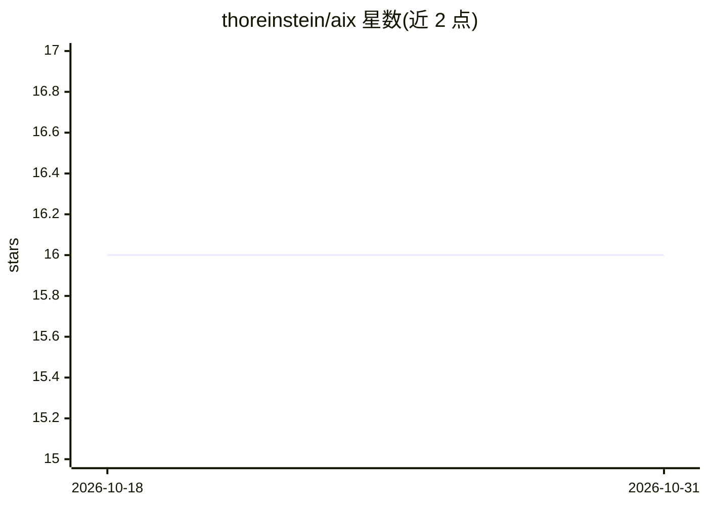

# thoreinstein/aix

⭐ 16 · Go · MIT · 推送 2026-08-02 · [GitHub](https://github.com/thoreinstein/aix) · [官网](https://thoreinstein.github.io/aix/) · 个人维护

**统一管理多 AI 编码助手配置的 CLI 工具**

aix 是用 Go 编写的命令行工具，为 Claude Code、OpenCode、Codex CLI、Gemini CLI 等多种 AI 编码助手提供统一的配置管理层：以平台无关格式定义一次配置，由 aix 转换为各平台原生格式。功能覆盖 MCP 服务器、可复用技能（skills）、自定义斜杠命令、AI agent 配置的管理，以及社区仓库（技能/命令/agent/MCP 配置的远程共享仓库）的添加与列表。通过 Homebrew、安装脚本或 go install 安装，MIT 许可。

## 筛选速览

| 维度 | 判定 | 备注 |
|---|---|---|
| AI 角色 | `ai-ecosystem` | LLM/agent 周边工具 |
| 许可风险 | `permissive` | MIT |
| 部署形态 | `library` | 以包/库形式分发 |
| 模型依赖 | — | README 未给出锁定关系 |
| 硬件要求 | — | 无带数字的原话,不猜 |
| 安装摩擦 | `low` | 无编译、无系统依赖或容器化 |
| 成熟度 | — | 结构信号不足 |

## 能力要点

- 一套配置转换为多平台原生格式（Claude Code/OpenCode/Codex CLI/Gemini CLI）
- 管理 MCP 服务器、技能、斜杠命令与 agent 配置
- 支持添加社区仓库共享技能、命令、agent 与 MCP 配置
- aix init 自动检测已安装平台并生成配置文件

## 适用场景

- 在多个 AI 编码助手间复用同一套技能与 MCP 配置
- 从社区仓库获取并安装可共享的技能和命令
- 统一查看各平台已配置的 MCP 服务器与 agent

## 场景标签

 · 领域:开发者工具/AI 基础设施

## 证据(README 行号)

> L10: `aix` provides a single tool to manage skills, MCP servers, and slash commands for multiple AI coding assistants:
> L17: Write once, deploy everywhere. Define your configurations in a platform-agnostic format and let `aix` handle the tr

## 星数曲线

2026-10-18 16 → 2026-10-31 16（+0）

---
*卡片 v1 · prompt 1.4 · 生成 2026-10-30 · 置信度 mid · 依据 README sha `032c857caa44` · [字段定义](../../DATASET.md)*
