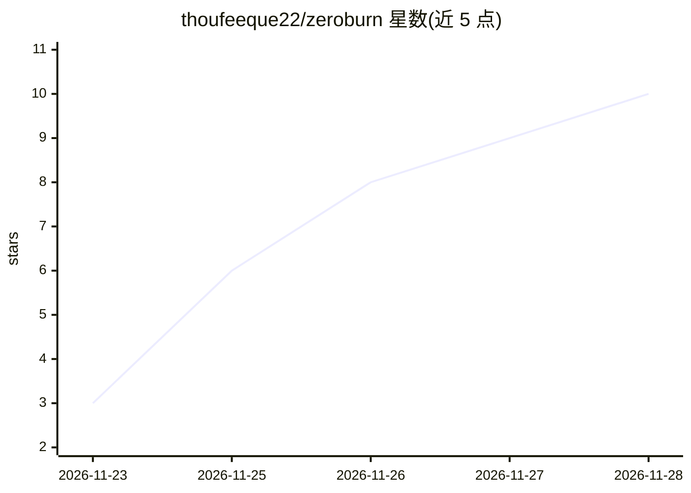

# thoufeeque22/zeroburn

⭐ 10 · JavaScript · MIT · 推送 2026-11-27 · [GitHub](https://github.com/thoufeeque22/zeroburn) · [官网](https://directly.social) · 组织维护

**降低 Claude/Gemini 编码代理 token 消耗的编排工具集**

一组以脚本、钩子和本地模型辅助形式提供的编码代理编排组件：通过静态 AST/鉴权/范围检查实现 0 云端 token 审计、压缩测试与 lint 输出为单行回执、预构建本地代码图索引替代探索性 find/grep、将机械性失败诊断与 diff 审查交给本地 Ollama 模型。需 Git 仓库与 Node.js 18+，本地 Ollama 为可选；通过 git clone 复制 .agents 目录并运行 init 脚本安装。

## 筛选速览

| 维度 | 判定 | 备注 |
|---|---|---|
| AI 角色 | `ai-ecosystem` | LLM/agent 周边工具 |
| 许可风险 | `permissive` | MIT |
| 部署形态 | `library` | 以包/库形式分发 |
| 模型依赖 | local-ok | 支持本地模型 |
| 硬件要求 | — | 无带数字的原话,不猜 |
| 安装摩擦 | `low` | 无编译、无系统依赖或容器化 |
| 成熟度 | — | 结构信号不足 |

## 能力要点

- quiet-cli.mjs 将通过运行的 Vitest/ESLint/TypeScript 输出压缩为 1 行回执，失败时由本地 Ollama 生成 3 行诊断
- codebase-memory-mcp 提供本地 SQLite/AST 符号索引，读取时对照实时文件系统校验行号有效性
- 两级混合审计：Python 确定性规则与本地 Ollama 预筛，云端 frontier 模型作最终裁决
- swarm_leases.json 文件锁防止并行子代理同时编辑同一文件

## 适用场景

- 在多代理工作流中减少测试日志与规则文件加载消耗的上下文 token
- 用本地模型完成 diff 审查与失败诊断，降低云端 API 配额消耗
- 并行子代理协作时避免文件编辑冲突

## 场景标签

`多智能体` `编码 Agent` · 领域:Agent 开发

## 证据(README 行号)

> L3: > **Cut AI coding-agent cloud API token & quota burn by 70–83%** by eliminating test/discovery output bloat, queryin
> L77: Instead of relying on proprietary agent runtimes or buzzwords, ZeroBurn is a set of transparent scripts, hooks, and

## 星数曲线

2026-11-23 3 → 2026-11-28 10（+7）

---
*卡片 v1 · prompt 1.4 · 生成 2026-11-23 · 置信度 mid · 依据 README sha `8728a4e33153` · [字段定义](../../DATASET.md)*
