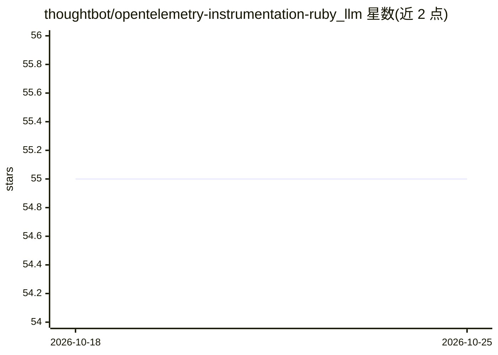

# thoughtbot/opentelemetry-instrumentation-ruby_llm

⭐ 55 · Ruby · MIT · 推送 2026-08-28 · [GitHub](https://github.com/thoughtbot/opentelemetry-instrumentation-ruby_llm) · 组织维护

**为 RubyLLM 提供 OpenTelemetry 可观测性追踪的 Ruby gem**

thoughtbot 维护的 OpenTelemetry instrumentation 库，为 RubyLLM 框架的 chat completions、tool calls、embeddings、Agent 调用生成遵循 GenAI 语义约定的 trace/span。消息内容默认不采集，可通过 capture_content 或环境变量开启（含 PII 警告）；支持自定义属性注入（with_otel_attributes）、会话与用户追踪、工具结果截断配置。Agent 追踪需 ruby_llm >= 1.12.1，Streaming 状态为 Planned。兼容 Ruby 3.1–3.4。

## 筛选速览

| 维度 | 判定 | 备注 |
|---|---|---|
| AI 角色 | `ai-ecosystem` | LLM/agent 周边工具 |
| 许可风险 | `permissive` | MIT |
| 部署形态 | `None` |  |
| 模型依赖 | — | README 未给出锁定关系 |
| 硬件要求 | — | 无带数字的原话,不猜 |
| 安装摩擦 | `low` | 无编译、无系统依赖或容器化 |
| 成熟度 | — | 结构信号不足 |

## 能力要点

- 覆盖 chat completions、tool calls、embeddings、Agent 调用（invoke_agent span）的追踪
- 遵循 OpenTelemetry GenAI Semantic Conventions
- 内容采集默认关闭，可通过配置或环境变量开启
- with_otel_attributes 支持自定义属性（可为 Proc）并沿链式调用传递

## 适用场景

- 在 Langfuse 等可观测性后端中查看 LLM 应用的调用 trace
- 对 Rails 中持久化的多轮会话做 conversation 级关联追踪
- 为 Agent 的工具循环与补全调用建立统一 trace 根节点

## 场景标签

`LLM 可观测性` · 领域:评测与运维

## 证据(README 行号)

> L3: OpenTelemetry instrumentation for RubyLLM.
> L194: This gem follows the OpenTelemetry GenAI Semantic Conventions.

## 星数曲线

2026-10-18 55 → 2026-10-25 55（+0）

---
*卡片 v1 · prompt 1.4 · 生成 2026-10-24 · 置信度 high · 依据 README sha `c0e0e32e95d6` · [字段定义](../../DATASET.md)*
