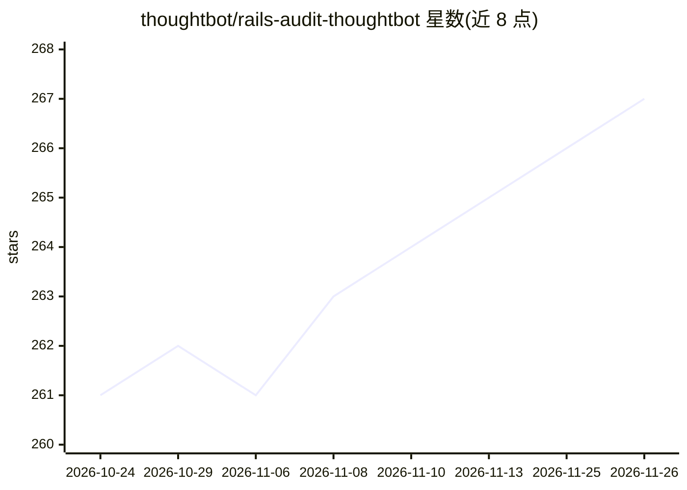

# thoughtbot/rails-audit-thoughtbot

⭐ 267 · MIT · 推送 2026-10-30 · [GitHub](https://github.com/thoughtbot/rails-audit-thoughtbot) · [官网](https://thoughtbot.com) · 组织维护

**Rails 代码审计的 Claude Code 技能：按 thoughtbot 实践生成审计报告**

一个 Claude Code 技能，依据 thoughtbot 的 Ruby Science 与 Testing Rails 实践对 Ruby on Rails 应用执行代码审计，生成涵盖测试实践、安全漏洞、代码设计、Rails 约定、数据库优化、性能反模式等维度的详细审计报告。审计可全量运行也可定向到特定文件或目录；支持可选的数据收集步骤（SimpleCov 覆盖率、RubyCritic 代码质量），均为 opt-in 并在收集后恢复原 Gemfile。内置参考文档与两个子代理定义。安装走 Claude Code 插件市场或手动复制/克隆到 skills 目录。

## 筛选速览

| 维度 | 判定 | 备注 |
|---|---|---|
| AI 角色 | `ai-native` | 本体是模型或模型工具 |
| 许可风险 | `permissive` | MIT |
| 部署形态 | `None` |  |
| 模型依赖 | — | README 未给出锁定关系 |
| 硬件要求 | — | 无带数字的原话,不猜 |
| 安装摩擦 | `low` | 无编译、无系统依赖或容器化 |
| 成熟度 | — | 结构信号不足 |

## 能力要点

- 生成覆盖测试、安全、设计、约定、数据库、性能等维度的审计报告
- 支持定向审计特定文件或目录
- 可选 SimpleCov 覆盖率与 RubyCritic 质量指标数据收集（opt-in，收集后恢复 Gemfile）
- 内置 Ruby Science/Testing Rails 提炼的参考文档与报告模板

## 适用场景

- 对 Rails 项目做全面代码质量与安全审计
- 针对性检查 controllers 等特定目录的代码问题
- 收集测试覆盖率与代码复杂度指标写入审计报告

## 场景标签

`代码审查` · 领域:编码与开发

## 证据(README 行号)

> L3: A [Claude Code][claude-code] skill that performs comprehensive code audits of
> L18: This skill analyses Rails applications and generates detailed audit reports

## 星数曲线

2026-10-24 261 → 2026-11-26 267（+6）

---
*卡片 v1 · prompt 1.4 · 生成 2026-11-25 · 置信度 high · 依据 README sha `f102abfd5eb4` · [字段定义](../../DATASET.md)*
