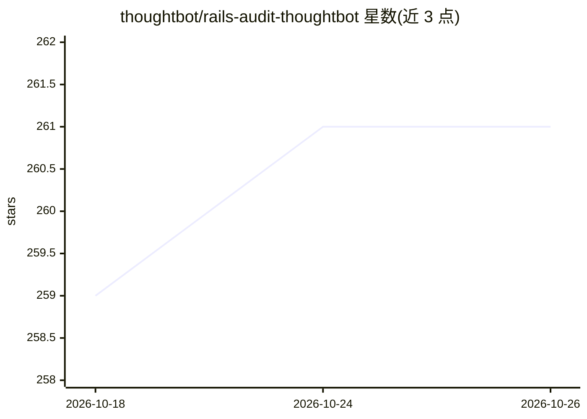

# thoughtbot/rails-audit-thoughtbot

⭐ 261 · MIT · 推送 2026-08-21 · [GitHub](https://github.com/thoughtbot/rails-audit-thoughtbot) · [官网](https://thoughtbot.com) · 组织维护

**Claude Code 技能：对 Rails 应用按 thoughtbot 规范做代码审计**

面向 Claude Code 的技能（skill），对 Ruby on Rails 应用执行代码审计并生成报告：覆盖 RSpec 测试实践、安全漏洞、代码设计（瘦控制器/PORO）、Rails 约定、数据库优化、外部服务与性能反模式等。审计依据来自 thoughtbot 的 Ruby Science、Testing Rails 与 Rails Antipatterns 等资料的压缩参考文档。可选步骤（每步 opt-in）临时向 Gemfile 添加 SimpleCov/RubyCritic 采集覆盖率与质量指标，跑完恢复原 Gemfile 并清理生成文件。安装方式为复制或克隆技能目录到 ~/.claude/skills/。

## 筛选速览

| 维度 | 判定 | 备注 |
|---|---|---|
| AI 角色 | `ai-ecosystem` | LLM/agent 周边工具 |
| 许可风险 | `permissive` | MIT |
| 部署形态 | `None` |  |
| 模型依赖 | — | README 未给出锁定关系 |
| 硬件要求 | — | 无带数字的原话,不猜 |
| 安装摩擦 | `low` | 无编译、无系统依赖或容器化 |
| 成熟度 | — | 结构信号不足 |

## 能力要点

- 基于 thoughtbot Ruby Science / Testing Rails 等实践的多维度 Rails 审计
- 可选 SimpleCov 覆盖率与 RubyCritic 复杂度/坏味道采集（临时改 Gemfile，事后还原）
- 支持全应用审计与针对 controllers 等指定目录的定向审计
- 附带 6 份参考文档与 2 个采集子代理定义

## 适用场景

- 让 Claude Code 对我的 Rails 项目生成全面审计报告
- 只审计 controllers 等特定目录的代码质量
- 在审计报告中获得实际测试覆盖率与代码复杂度数据

## 场景标签

`代码审查` · 领域:编码与开发

## 证据(README 行号)

> L3: A [Claude Code][claude-code] skill that performs comprehensive code audits of
> L18: This skill analyses Rails applications and generates detailed audit reports

## 星数曲线

2026-10-18 259 → 2026-10-26 261（+2）

---
*卡片 v1 · prompt 1.4 · 生成 2026-10-22 · 置信度 high · 依据 README sha `866303be7a21` · [字段定义](../../DATASET.md)*
