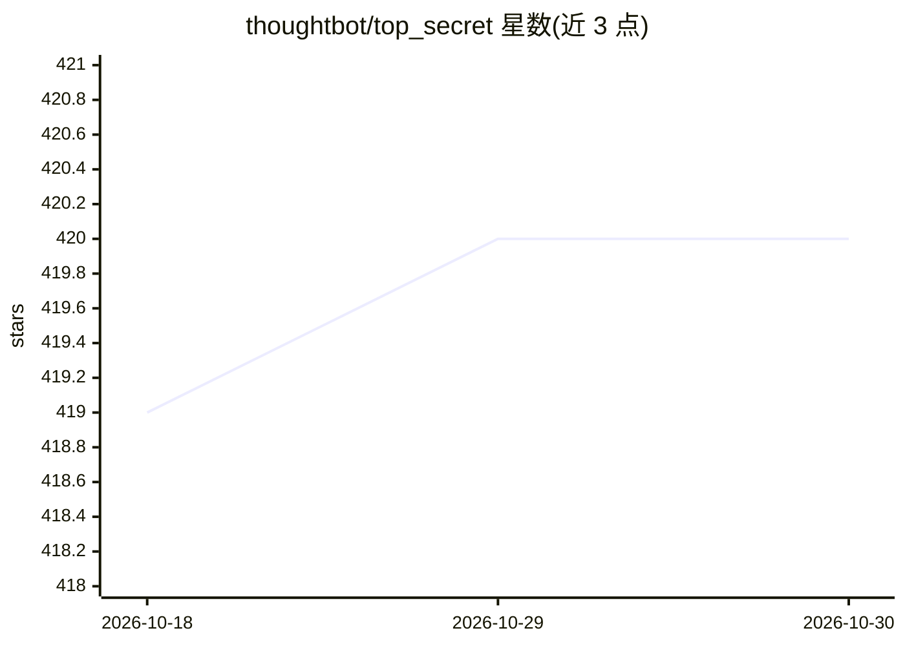

# thoughtbot/top_secret

⭐ 420 · Ruby · MIT · 推送 2026-05-14 · [GitHub](https://github.com/thoughtbot/top_secret) · [官网](https://thoughtbot.com/blog/top-secret) · 组织维护

**Ruby 库：发送文本给 LLM 前过滤 PII 并可还原**

Ruby gem，在自由文本发送到外部服务（如聊天机器人、LLM）前检测并脱敏敏感信息。默认六类过滤器：正则类（信用卡、邮箱、电话、SSN）与基于 MITIE NER 模型的姓名、位置检测，输出替换占位符及原文映射；支持仅扫描不脱敏（scan）、批量处理（跨消息标签一致）、占位符还原（restore），可覆盖、禁用或新增自定义正则/NER 过滤器。使用 NER 需自行下载 ner_model.dat 模型文件；若仅需正则过滤可将 model_path 设为 nil 以免除模型依赖。

## 筛选速览

| 维度 | 判定 | 备注 |
|---|---|---|
| AI 角色 | `ai-native` | 本体是模型或模型工具 |
| 许可风险 | `permissive` | MIT |
| 部署形态 | `None` |  |
| 模型依赖 | — | README 未给出锁定关系 |
| 硬件要求 | — | 无带数字的原话,不猜 |
| 安装摩擦 | `low` | 无编译、无系统依赖或容器化 |
| 成熟度 | — | 结构信号不足 |

## 能力要点

- 正则 + MITIE NER 双类过滤器，默认覆盖 6 类敏感信息
- filter/scan/filter_all/restore 四种使用模式，占位符可还原回原文
- 批量处理时相同值跨消息使用一致标签
- 支持自定义正则与 NER 过滤器（MITIE 支持训练自定义模型）

## 适用场景

- 把用户输入发给 LLM 前脱敏邮箱、姓名、SSN 等个人信息
- 仅检测文本是否含敏感信息而不修改原文
- 对 LLM 返回内容中的占位符还原为原始值

## 场景标签

 · 领域:数据隐私/文本处理

## 证据(README 行号)

> L5: Filter sensitive information from free text before sending it to external services or APIs, such as chatbots and LLM
> L109: Detects names of people (NER-based)
> L38: > Top Secret depends on [MITIE Ruby][], which depends on [MITIE][].

## 星数曲线

2026-10-18 419 → 2026-10-30 420（+1）

---
*卡片 v1 · prompt 1.4 · 生成 2026-10-22 · 置信度 high · 依据 README sha `7eb488464c01` · [字段定义](../../DATASET.md)*
