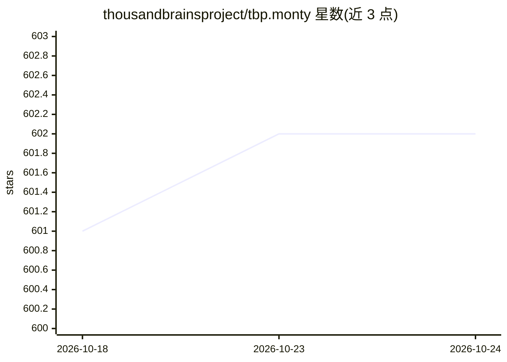

# thousandbrainsproject/tbp.monty

⭐ 602 · Python · MIT · 推送 2026-10-22 · [GitHub](https://github.com/thousandbrainsproject/tbp.monty) · [官网](https://thousandbrainsproject.readme.io) · 组织维护

**基于千脑理论的感知运动学习框架，供研究者实验**

Thousand Brains Project 开源的感知运动学习系统实现，遵循新皮层千脑理论原理，以发现 cortical columns 功能单元的 Vernon Mountcastle 命名为 Monty。项目最初在 Numenta 启动，现由独立非营利组织维护，部分由盖茨基金会资助。系统定期在一组感知运动基准任务上评估，实验配置存放于 src/tbp/monty/conf/experiment/ 目录，功能变更后自动重跑并更新结果。README 声明为早期 beta 版本，处于活跃开发中，非生产就绪代码。MIT 许可。

## 筛选速览

| 维度 | 判定 | 备注 |
|---|---|---|
| AI 角色 | `ai-native` | 本体是模型或模型工具 |
| 许可风险 | `permissive` | MIT |
| 部署形态 | `library` | 以包/库形式分发 |
| 模型依赖 | — | README 未给出锁定关系 |
| 硬件要求 | — | 无带数字的原话,不猜 |
| 安装摩擦 | `low` | 无编译、无系统依赖或容器化 |
| 成熟度 | `idea` | |

## 能力要点

- 千脑理论感知运动学习系统的首个实现
- 定期在基准实验上评估并更新结果
- 实验配置以代码形式存放于仓库
- 配套白皮书（arXiv:2412.18354）与论文可引用

## 适用场景

- 研究感知运动学习与千脑理论的代码实现
- 复现或扩展感知运动基准实验
- 基于皮层柱模型开展学习与推理研究

## 场景标签

`科研工具` `模型评测` · 领域:评测与运维

## 证据(README 行号)

> L3: *An open-source, sensorimotor learning system following the principles of the neocortex.*
> L8: This repository contains the first implementation of a **sensorimotor learning system** from the **Thousand Brains P
> L21: We regularly evaluate this system against a set of sensorimotor tasks, and report results in **benchmark experiment

## 星数曲线

2026-10-18 601 → 2026-10-24 602（+1）

---
*卡片 v1 · prompt 1.4 · 生成 2026-10-21 · 置信度 high · 依据 README sha `d5d9c3604240` · [字段定义](../../DATASET.md)*
