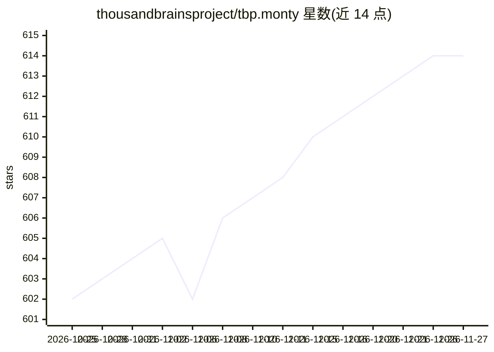

# thousandbrainsproject/tbp.monty

⭐ 614 · Python · MIT · 推送 2026-11-25 · [GitHub](https://github.com/thousandbrainsproject/tbp.monty) · [官网](https://thousandbrainsproject.readme.io) · 组织维护

**面向研究者的感觉运动学习框架 Monty（千脑理论实现）**

Thousand Brains Project 的首个感觉运动学习系统实现，以 Python 包形式发布，基于新皮质皮层柱原理构建。项目提供完整文档与 API 文档，维护一组感觉运动任务基准实验：每次功能性代码变更后重跑实验并更新结果，实验配置位于 src/tbp/monty/conf/experiment/。README 声明当前为早期 beta 版本，功能可用但处于活跃开发中，预期频繁变更，非生产就绪代码。采用 MIT 许可证。

## 筛选速览

| 维度 | 判定 | 备注 |
|---|---|---|
| AI 角色 | `ai-native` | 本体是模型或模型工具 |
| 许可风险 | `permissive` | MIT |
| 部署形态 | `library` | 以包/库形式分发 |
| 模型依赖 | — | README 未给出锁定关系 |
| 硬件要求 | — | 无带数字的原话,不猜 |
| 安装摩擦 | `low` | 无编译、无系统依赖或容器化 |
| 成熟度 | `idea` | |

## 能力要点

- 基于千脑理论的感觉运动学习系统首个实现
- 内置感觉运动任务基准实验，随代码变更持续重跑并报告结果
- 提供完整文档与 API 文档
- MIT 许可证开源

## 适用场景

- 搭建和运行感觉运动学习基准实验
- 研究基于皮层柱原理的学习与推理机制
- 复现并追踪千脑系统的性能评测结果

## 场景标签

`模型评测` `科研工具` · 领域:评测与运维

## 证据(README 行号)

> L8: This repository contains the first implementation of a **sensorimotor learning system** from the **Thousand Brains P
> L21: We regularly evaluate this system against a set of sensorimotor tasks, and report results in **benchmark experiment

## 星数曲线

2026-10-25 602 → 2026-11-27 614（+12）

---
*卡片 v1 · prompt 1.4 · 生成 2026-11-25 · 置信度 mid · 依据 README sha `bdb06facb463` · [字段定义](../../DATASET.md)*
