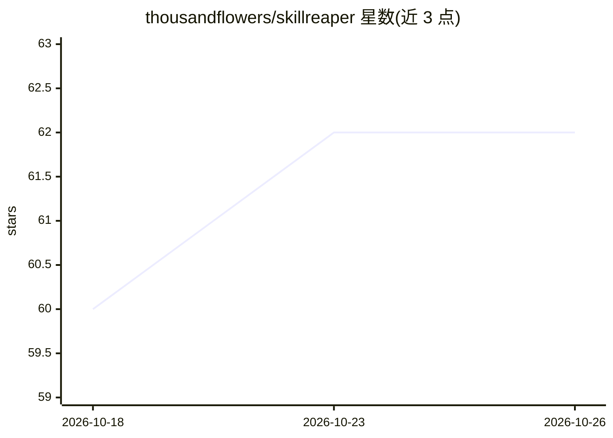

# thousandflowers/skillreaper

⭐ 62 · Go · MIT · 推送 2026-08-30 · [GitHub](https://github.com/thousandflowers/skillreaper) · 个人维护

**测量并清理 AI agent 技能/MCP/子代理的上下文冗余项**

本地运行的 CLI 工具，读取已有的会话 transcript，统计 agent 加载的技能、MCP 服务器、子代理、hooks 中哪些从未触发，输出每项的判定（REAP/MUTE/KEEP/REVIEW）与 token 成本；通过 reap prune 将死项移入 reaped/ 隔离目录（可 restore 回滚），reap mute 剥离低频重项描述。所有测量命令只读，写入均可逆且原子，零网络。面向使用 Claude Code 等 agent 的开发者，通过 npx/Homebrew/npm/静态二进制分发。

## 筛选速览

| 维度 | 判定 | 备注 |
|---|---|---|
| AI 角色 | `ai-ecosystem` | LLM/agent 周边工具 |
| 许可风险 | `permissive` | MIT |
| 部署形态 | `desktop` | 安装包/桌面程序 |
| 模型依赖 | — | README 未给出锁定关系 |
| 硬件要求 | — | 无带数字的原话,不猜 |
| 安装摩擦 | `low` | 无编译、无系统依赖或容器化 |
| 成熟度 | — | 结构信号不足 |

## 能力要点

- 基于会话 transcript 证据区分已加载与实际触发项
- reap prune 隔离死项，reap restore 可逆回滚，写入原子且限于 Claude 目录
- reap gap 输出各类别利用率与 MCP 工具载荷质量评分
- 100% 本地运行，零遥测零网络

## 适用场景

- 查看 agent 每会话加载了多少从未使用的技能和 MCP
- 把不用的技能/MCP 隔离掉以节省 token 和上下文预算
- 对比清理前后或跨项目追踪技能实际使用情况

## 场景标签

`LLM 可观测性` · 领域:评测与运维

## 证据(README 行号)

> L14:  skillreaper finds the unused skills, MCP servers, subagents, hooks and
> L44: skillreaper is a **measuring instrument** for your agent's context window.

## 星数曲线

2026-10-18 60 → 2026-10-26 62（+2）

---
*卡片 v1 · prompt 1.4 · 生成 2026-10-24 · 置信度 high · 依据 README sha `985098075561` · [字段定义](../../DATASET.md)*
