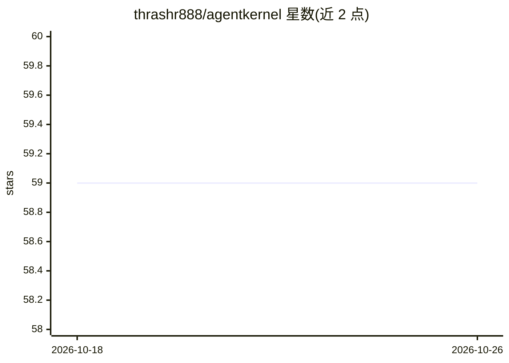

# thrashr888/agentkernel

⭐ 59 · Rust · MIT · 推送 2026-10-25 · [GitHub](https://github.com/thrashr888/agentkernel) · [官网](https://thrashr888.github.io/agentkernel/) · 个人维护

**在隔离 microVM/沙箱中运行 AI 编程 agent 的安全执行框架**

Rust 编写的沙箱执行框架：以 Firecracker microVM（宣称低于 125ms 启动）或 Docker 容器为后端，为 AI 编程 agent（Claude Code、Codex、Gemini CLI、OpenCode）提供硬件级隔离的运行环境。核心机制包括：按命令/项目文件自动检测运行时并选镜像（支持 14 种语言）、三档安全配置、SSH 证书访问、快照与并行流水线、网络层密钥注入（secret 不进 VM）、LLM 模型治理代理与多租户允许列表。提供 CLI、HTTP API 与 5 种语言官方 SDK。限制：全状态生命周期需 Firecracker 1.16.1 与 x86_64 Linux/KVM 主机，其他后端返回不支持错误。

## 筛选速览

| 维度 | 判定 | 备注 |
|---|---|---|
| AI 角色 | `ai-ecosystem` | LLM/agent 周边工具 |
| 许可风险 | `permissive` | MIT |
| 部署形态 | `self-host` | docker 或自建部署 |
| 模型依赖 | — | README 未给出锁定关系 |
| 硬件要求 | — | 无带数字的原话,不猜 |
| 安装摩擦 | `low` | 无编译、无系统依赖或容器化 |
| 成熟度 | — | 结构信号不足 |

## 能力要点

- Firecracker microVM 硬件隔离沙箱，宣称低于 125ms 启动
- 网络层密钥注入：真实 secret 不进入 VM，按域名作用域注入
- 14 种语言的运行时自动检测与镜像选择
- LLM 代理支持租户级模型允许列表治理，未列模型 403 拒绝

## 适用场景

- 让 AI 编程 agent 在隔离沙箱中执行不可信代码
- 为 agent 的 LLM 调用集中管理 API 密钥并防止外泄
- 多 agent 任务通过流水线与并行沙箱编排执行
- 企业按租户治理 agent 可用的 LLM 模型

## 场景标签

`Agent 框架` · 领域:Agent 开发

## 证据(README 行号)

> L3: Run AI coding agents in secure, isolated microVMs. Sub-125ms boot times, real hardware isolation.
> L303: Check which AI coding agents are available:
> L306: agentkernel agents

## 星数曲线

2026-10-18 59 → 2026-10-26 59（+0）

---
*卡片 v1 · prompt 1.4 · 生成 2026-10-24 · 置信度 mid · 依据 README sha `e859fe282be6` · [字段定义](../../DATASET.md)*
