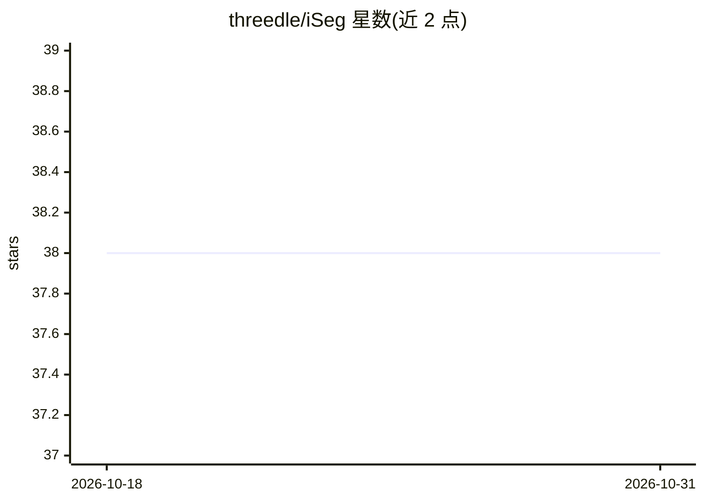

# threedle/iSeg

⭐ 38 · Jupyter Notebook · MIT · 推送 2026-05-28 · [GitHub](https://github.com/threedle/iSeg) · [官网](https://threedle.github.io/iSeg/) · 组织维护

**面向研究者：基于用户点击的交互式 3D 形状分割方法**

SIGGRAPH 论文配套的 3D 分割研究代码：用户直接在形状表面点击正/负点指定包含或排除区域，系统通过交互式注意力模块处理不同数量与类型的点击，单一统一模型完成分割，全程在 3D 上操作。提供预训练模型与锤子网格的演示、可点击交互界面（支持撤销/重做/重置），以及编码器与解码器的训练流程（编码器训练需下载 SAM ViT-H 权重）。安装假设机器具备 GPU 和 CUDA。

## 筛选速览

| 维度 | 判定 | 备注 |
|---|---|---|
| AI 角色 | `ai-native` | 本体是模型或模型工具 |
| 许可风险 | `permissive` | MIT |
| 部署形态 | `None` |  |
| 模型依赖 | — | README 未给出锁定关系 |
| 硬件要求 | — | 无带数字的原话,不猜 |
| 安装摩擦 | `medium` | 含编译或系统依赖之一 |
| 成熟度 | — | 结构信号不足 |

## 能力要点

- 直接在 3D 形状表面点击正/负点进行分割
- 交互式注意力模块统一处理不同数量与类型的点击
- 提供交互式演示界面（Undo/Redo/Reset）与预训练模型
- 含编码器与解码器的数据生成与训练脚本

## 适用场景

- 在 3D 网格上通过点击交互式地划分语义区域
- 复现论文并进行编码器/解码器训练
- 在自有网格数据上评测交互式分割效果

## 场景标签

 · 领域:3D 计算机图形学/几何深度学习

## 证据(README 行号)

> L27: We present iSeg, a new interactive technique for segmenting 3D shapes. Previous works have focused mainly on levera
> L53: Note: the installation assumes a machine with a GPU and CUDA.

## 星数曲线

2026-10-18 38 → 2026-10-31 38（+0）

---
*卡片 v1 · prompt 1.4 · 生成 2026-10-25 · 置信度 high · 依据 README sha `d78e553edab9` · [字段定义](../../DATASET.md)*
