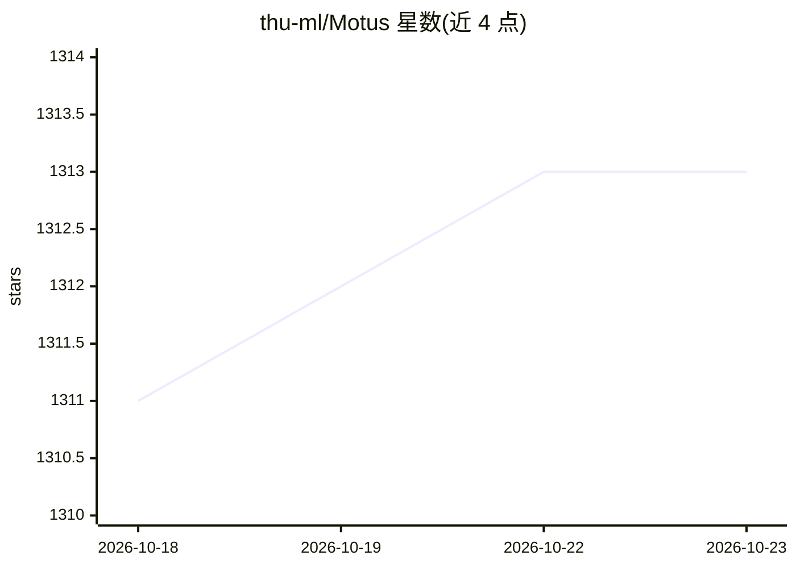

# thu-ml/Motus

⭐ 1,313 · Python · Apache-2.0 · 推送 2026-10-09 · [GitHub](https://github.com/thu-ml/Motus) · [官网](https://motus-robotics.github.io/motus) · 组织维护 · 中文 README

**统一潜动作世界模型：机器人的视频生成与视觉-语言-动作预测**

清华大学团队（thu-ml）发布的机器人世界模型官方代码：以 Mixture-of-Transformers 架构整合理解、动作、视频生成三个专家，采用 UniDiffuser 式调度器，可在世界模型、VLA、逆动力学、视频生成、视频-动作联合预测等模式间切换。基于 Wan2.2-5B 与 Qwen3-VL-2B，总参数约 8B；用光流学习潜动作，按三阶段流水线与六层数据金字塔训练。提供预训练检查点、训练脚本与 RoboTwin 2.0 / 真实机器人（AC-One、Aloha-Agilex-2）数据支持；训练需 80GB 以上显存的 GPU。

## 筛选速览

| 维度 | 判定 | 备注 |
|---|---|---|
| AI 角色 | `ai-native` | 本体是模型或模型工具 |
| 许可风险 | `permissive` | Apache-2.0 |
| 部署形态 | `None` |  |
| 模型依赖 | — | README 未给出锁定关系 |
| 硬件要求 | — | 无带数字的原话,不猜 |
| 安装摩擦 | `low` | 无编译、无系统依赖或容器化 |
| 成熟度 | — | 结构信号不足 |

## 能力要点

- MoT 架构整合理解/动作/视频生成三专家，约 8B 参数
- 光流学习潜动作，三阶段训练与六层数据金字塔
- 提供预训练/微调/推理三类检查点（Hugging Face）
- 支持 RoboTwin 2.0 与真实机器人数据（LeRobotDataset 格式）

## 适用场景

- 机器人操作任务的仿真评测（RoboTwin 2.0）
- 在自有机器人数据上做三阶段微调
- 视频生成与动作联合预测研究

## 场景标签

`视频生成` `多模态` `微调` `模型训练` · 领域:内容生成

## 证据(README 行号)

> L21: **Motus** is a **unified latent action world model** that leverages existing pretrained models and rich, sharable m
> L25: |**VGM (Video Generation Model)**|Wan2.2-5B|~5.00B|
> L26: |**VLM (Vision-Language Model)**|Qwen3-VL-2B|~2.13B|

## 星数曲线

2026-10-18 1,311 → 2026-10-23 1,313（+2）

---
*卡片 v1 · prompt 1.4 · 生成 2026-10-21 · 置信度 high · 依据 README sha `97500066a30c` · [字段定义](../../DATASET.md)*
