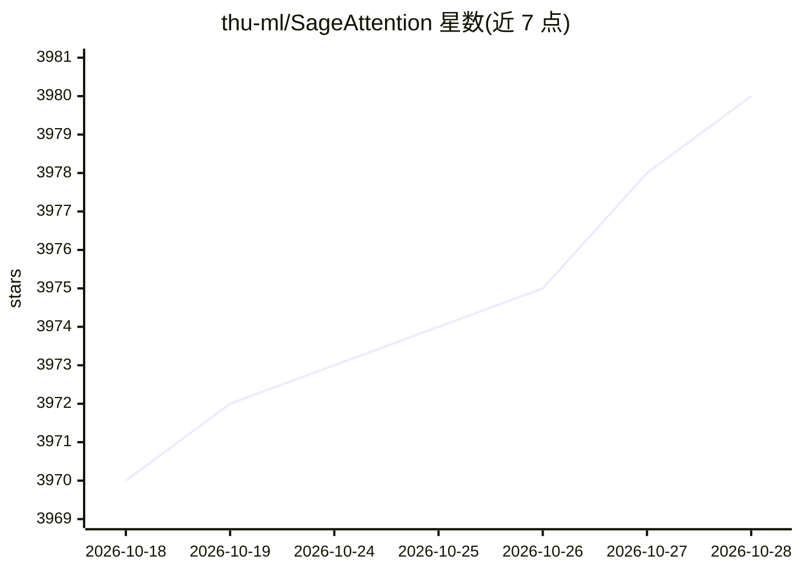

# thu-ml/SageAttention

⭐ 3,981 · Cuda · Apache-2.0 · 推送 2026-01-17 · [GitHub](https://github.com/thu-ml/SageAttention) · [官网](https://arxiv.org/abs/2410.02367) · 组织维护 · 中文 README

**量化注意力算子库：为 GPU 推理提供 2-5x 提速的即插即用 attention 内核**

清华 thu-ml 团队开源的量化 attention 内核官方实现，覆盖 SageAttention/2/2++/3 三代。通过对 QK^T 做 INT8 量化与平滑、对 PV 做 FP8/FP16 量化并采用两级累加策略，在 Ampere/Ada/Hopper/Blackwell GPU 上以即插即用方式替换 scaled_dot_product_attention，加速语言、图像与视频模型推理，README 给出 CogVideoX 替换示例与内核基准脚本。安装支持 pip 与源码编译，需满足 python/torch/triton/CUDA 版本要求；README 注明并非所有模型可直接替换，建议修改目标模型 Attention 类。

## 筛选速览

| 维度 | 判定 | 备注 |
|---|---|---|
| AI 角色 | `ai-ecosystem` | LLM/agent 周边工具 |
| 许可风险 | `permissive` | Apache-2.0 |
| 部署形态 | `library` | 以包/库形式分发 |
| 模型依赖 | — | README 未给出锁定关系 |
| 硬件要求 | — | 无带数字的原话,不猜 |
| 安装摩擦 | `high` | 编译与系统依赖俱全 |
| 成熟度 | — | 结构信号不足 |

## 能力要点

- INT8 QK^T 量化+平滑、FP8/FP16 PV 量化与两级累加
- 面向 Ampere/Ada/Hopper（及 RTX5090/Blackwell）优化的多后端内核
- 可一行替换 F.scaled_dot_product_attention，提供 sageattn 自动选核 API
- 支持 torch.compile（非 cudagraphs 模式）、分布式推理与变长序列

## 适用场景

- 视频/图像生成模型推理加速（如 CogVideoX）
- LLM 推理中替换默认 attention 内核提速
- 对比 FlashAttention2/3 做内核基准测试

## 场景标签

`模型量化` `推理引擎` · 领域:训练与推理

## 证据(README 行号)

> L3: This repository provides the official implementation of SageAttention, SageAttention2, and SageAttention2++, which a
> L22: + Optmized kernels for **Ampere, Ada and Hopper GPUs.**
> L120: We can replace `scaled_dot_product_attention` easily.

## 星数曲线

2026-10-18 3,970 → 2026-10-28 3,980（+10）

---
*卡片 v1 · prompt 1.4 · 生成 2026-10-20 · 置信度 high · 依据 README sha `828452b6fc71` · [字段定义](../../DATASET.md)*
