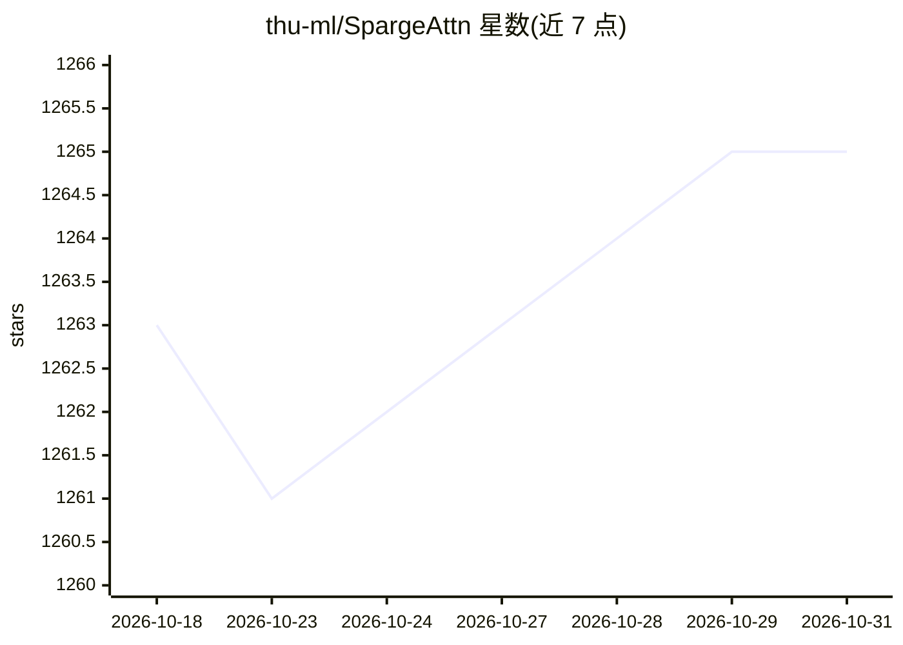

# thu-ml/SpargeAttn

⭐ 1,265 · Cuda · Apache-2.0 · 推送 2026-02-25 · [GitHub](https://github.com/thu-ml/SpargeAttn) · [官网](https://arxiv.org/abs/2502.18137) · 组织维护

**免训练稀疏注意力库：加速语言/图像/视频模型推理**

ICML 2025 论文 SpargeAttention 的官方实现，基于 SageAttention2 的免训练稀疏注意力内核，通过替换 torch 的 scaled_dot_product_attention 调用即插即用地加速任意模型推理。提供 topk 可调的 plug-and-play API 与可自定义每头块稀疏掩码（块大小 128×64）的 API，另有 Triton 内核示例。需要 Python>=3.9、torch>=2.3.0 与 CUDA，经 setup.py 或 pip install -e 编译安装，面向模型推理优化的开发者。

## 筛选速览

| 维度 | 判定 | 备注 |
|---|---|---|
| AI 角色 | `ai-ecosystem` | LLM/agent 周边工具 |
| 许可风险 | `permissive` | Apache-2.0 |
| 部署形态 | `library` | 以包/库形式分发 |
| 模型依赖 | — | README 未给出锁定关系 |
| 硬件要求 | — | 无带数字的原话,不猜 |
| 安装摩擦 | `high` | 编译与系统依赖俱全 |
| 成熟度 | — | 结构信号不足 |

## 能力要点

- 基于 SageAttention2 的免训练稀疏注意力内核
- 即插即用替换 torch.nn.functional.scaled_dot_product_attention
- topk 参数可在注意力精度与稀疏度之间调节
- 支持自定义每注意力头的块稀疏掩码（块大小 128×64）

## 适用场景

- 加速语言、图像、视频 Transformer 模型的推理
- 在推理中替换 SDPA 调用以降低注意力计算开销
- 按自定义块稀疏掩码控制注意力计算范围

## 场景标签

`推理引擎` · 领域:训练与推理

## 证据(README 行号)

> L24: The official implementation of SpargeAttn, a universal training-free sparse attention accelerating language, image,
> L72: Just replace `torch.nn.functional.scaled_dot_product_attention` API using `spas_sage2_attn_meansim_topk_cuda`:

## 星数曲线

2026-10-18 1,263 → 2026-10-31 1,265（+2）

---
*卡片 v1 · prompt 1.4 · 生成 2026-10-21 · 置信度 high · 依据 README sha `8a7463c35ae4` · [字段定义](../../DATASET.md)*
