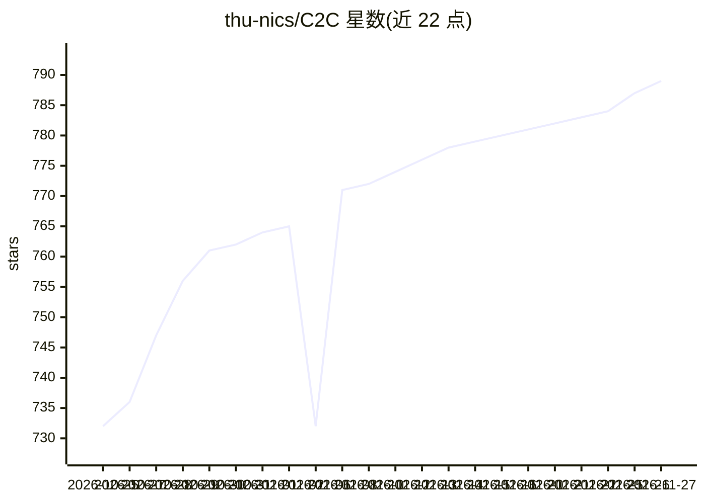

# thu-nics/C2C

⭐ 789 · Python · Apache-2.0 · 推送 2026-10-28 · [GitHub](https://github.com/thu-nics/C2C) · [官网](https://fuvty.github.io/thinking_yard_project_page/projects/c2c/) · 组织维护 · 中文 README

**让 LLM 间通过 KV-Cache 直接通信的研究代码库**

论文 Cache-to-Cache 的官方实现（Python 包 Rosetta）：通过投影与融合两个模型的 KV-Cache 实现直接语义通信，绕过文本生成环节，论文报告相较单模型与文本通信的精度与延迟数据。提供预训练 Fuser 权重加载、交互式 chat 示例、RosettaModel 通用包装器、Fuser 训练脚本与统一评测脚本，支持任意模型对的训练与自定义 projector/dataset/benchmark 扩展。面向 LLM 通信方向的研究者，安装依赖 conda 环境与 pip。

## 筛选速览

| 维度 | 判定 | 备注 |
|---|---|---|
| AI 角色 | `ai-native` | 本体是模型或模型工具 |
| 许可风险 | `permissive` | Apache-2.0 |
| 部署形态 | `library` | 以包/库形式分发 |
| 模型依赖 | — | README 未给出锁定关系 |
| 硬件要求 | — | 无带数字的原话,不猜 |
| 安装摩擦 | `low` | 无编译、无系统依赖或容器化 |
| 成熟度 | — | 结构信号不足 |

## 能力要点

- 通过投影/融合 KV-Cache 实现 LLM 间直接语义通信
- 提供 7 组预训练 projector 权重（Qwen3/Qwen2.5/Llama-3.2 组合）
- RosettaModel 包装器可应用于任意 LLM（自动处理维度/层数/头数/分词器差异）
- 训练时仅更新 projector 参数，源/目标模型冻结

## 适用场景

- 复现 ICLR'26 论文的 KV-Cache 融合实验
- 在自己的两个 LLM 之间训练缓存级通信 projector
- 运行多模型协作的交互式对话示例

## 场景标签

`多智能体` · 领域:Agent 开发

## 证据(README 行号)

> L11: Cache-to-Cache (C2C) enables Large Language Models to communicate directly through their KV-Caches, bypassing text 
> L96: You can apply C2C to your own LLMs with a few lines of code. We provide a universal `RosettaModel` wrapper.
> L140: - `rosetta/`: The main package for Cache-to-Cache.

## 星数曲线

2026-10-25 732 → 2026-11-27 789（+57）

---
*卡片 v1 · prompt 1.4 · 生成 2026-11-24 · 置信度 high · 依据 README sha `f7a7f8f3c072` · [字段定义](../../DATASET.md)*
