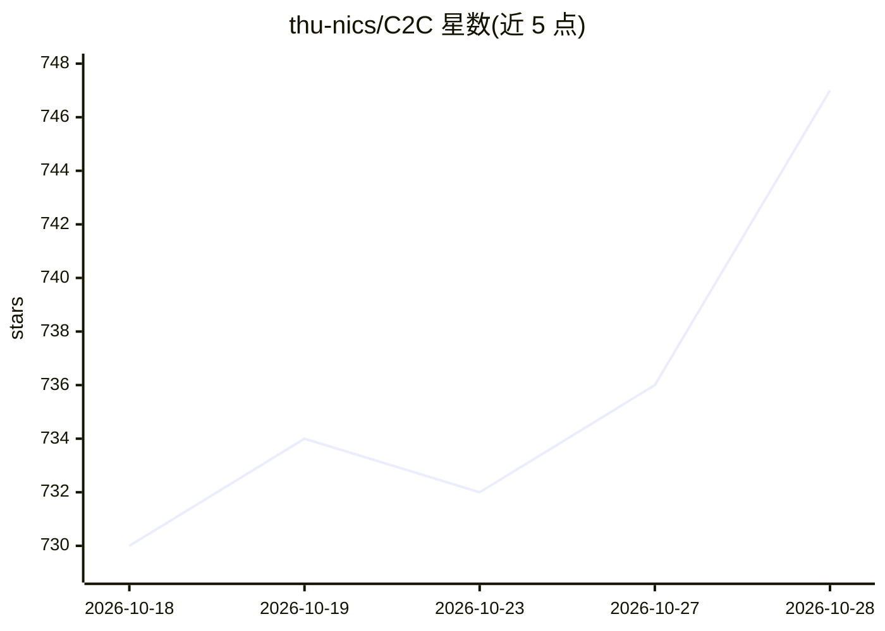

# thu-nics/C2C

⭐ 747 · Python · Apache-2.0 · 推送 2026-10-09 · [GitHub](https://github.com/thu-nics/C2C) · [官网](https://fuvty.github.io/thinking_yard_project_page/projects/c2c/) · 组织维护 · 中文 README

**让多个 LLM 通过 KV-Cache 直接语义通信的框架**

清华大学 thu-nics 团队发布的 ICLR'26 论文官方实现：通过投影器（projector）在模型间变换与融合 KV-Cache，绕过文本生成实现模型间通信；论文报告相对单模型准确率提升 8.5–10.5%、较文本通信提升 3.0–5.0%、延迟加速 2.0 倍。面向多模型协作场景，提供 Python 包（Rosetta）、HuggingFace 预训练 Fuser 权重、训练/评测脚本与 Gradio demo。仅训练 projector 参数，源/目标模型冻结；支持不同维度、层数、分词器的任意模型对。多 sharer 融合功能声明为初步阶段仍在开发。

## 筛选速览

| 维度 | 判定 | 备注 |
|---|---|---|
| AI 角色 | `ai-ecosystem` | LLM/agent 周边工具 |
| 许可风险 | `permissive` | Apache-2.0 |
| 部署形态 | `library` | 以包/库形式分发 |
| 模型依赖 | — | README 未给出锁定关系 |
| 硬件要求 | — | 无带数字的原话,不猜 |
| 安装摩擦 | `low` | 无编译、无系统依赖或容器化 |
| 成熟度 | `idea` | |

## 能力要点

- KV-Cache 投影与融合实现模型间直接通信，无需文本生成
- 仅更新 projector 参数，源与目标模型均冻结
- 支持不同隐藏维度/层数/分词器的任意模型对
- 提供预训练 Fuser 权重、训练/评测配置与交互式 chat 示例

## 适用场景

- 让两个 LLM 直接交换 KV-Cache 以融合语义提升回答准确率
- 训练自定义模型对的 C2C projector
- 对比 cache 通信与文本通信的准确率与延迟

## 场景标签

`多智能体` · 领域:Agent 开发

## 证据(README 行号)

> L11: Cache-to-Cache (C2C) enables Large Language Models to communicate directly through their KV-Caches, bypassing text 
> L156: Add a new projector architecture in `rosetta/model/projector.py`. The projector transforms source model's KV-Cache

## 星数曲线

2026-10-18 730 → 2026-10-28 747（+17）

---
*卡片 v1 · prompt 1.4 · 生成 2026-10-22 · 置信度 high · 依据 README sha `a0ec3b1a945d` · [字段定义](../../DATASET.md)*
