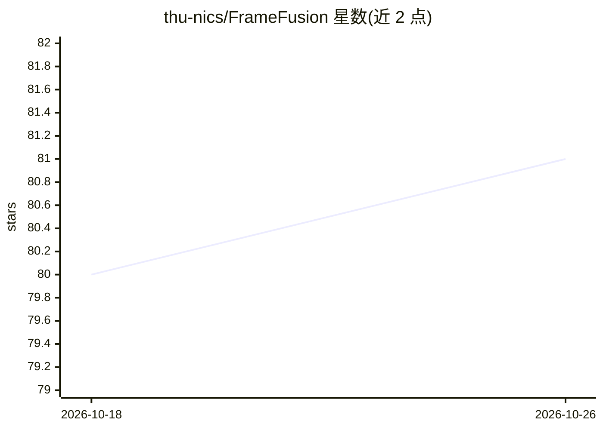

# thu-nics/FrameFusion

⭐ 81 · Python · MIT · 推送 2026-10-09 · [GitHub](https://github.com/thu-nics/FrameFusion) · [官网](https://fuvty.github.io/thinking_yard_project_page/projects/framefusion/) · 组织维护

**大型视觉语言模型的视频 token 压缩方法（ICCV'25 官方代码）**

清华大学团队的论文官方实现：在大型视觉语言模型（LVLMs）中结合基于相似度的合并与基于重要度的剪枝，减少视频 token 数量，论文报告 70% 视觉 token 削减、3.4–4.4 倍 LLM 加速与 1.6–1.9 倍端到端加速。以 Python 包提供，通过 apply_framefusion 接口接入 HuggingFace 模型，内置 LLaVA-Video、NVILA、Qwen2-VL、InternVL2.5、MiniCPM-V 的适配器，支持用 lmms-eval 评测与自行扩展新模型适配器。

## 筛选速览

| 维度 | 判定 | 备注 |
|---|---|---|
| AI 角色 | `ai-ecosystem` | LLM/agent 周边工具 |
| 许可风险 | `permissive` | MIT |
| 部署形态 | `library` | 以包/库形式分发 |
| 模型依赖 | — | README 未给出锁定关系 |
| 硬件要求 | — | 无带数字的原话,不猜 |
| 安装摩擦 | `low` | 无编译、无系统依赖或容器化 |
| 成熟度 | — | 结构信号不足 |

## 能力要点

- 相似度合并+重要度剪枝的视频 token 压缩，报告 70% token 削减
- apply_framefusion 数行代码接入 HuggingFace 模型
- 内置 5 个模型家族适配器，支持注册新模型适配器
- 提供 lmms-eval 评测流程与示例脚本

## 适用场景

- 给 LLaVA-Video/Qwen2-VL 等模型降低视频推理开销
- 研究视频 token 剪枝与压缩方法
- 复现论文的评测结果

## 场景标签

 · 领域:高效深度学习/多模态模型

## 证据(README 行号)

> L9: FrameFusion reduces the number of tokens in Large Vision-Language Models (LVLMs) by combining similarity-based mergi
> L105: You can apply FrameFusion in your own code to any huggingface model that supports the interface with few lines of 
> L116: We use lmms-eval to evaluate FrameFusion.

## 星数曲线

2026-10-18 80 → 2026-10-26 81（+1）

---
*卡片 v1 · prompt 1.4 · 生成 2026-10-24 · 置信度 high · 依据 README sha `f86b709aa808` · [字段定义](../../DATASET.md)*
