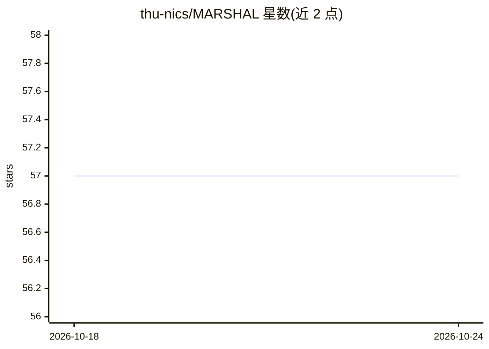

# thu-nics/MARSHAL

⭐ 57 · Python · Apache-2.0 · 推送 2026-10-13 · [GitHub](https://github.com/thu-nics/MARSHAL) · [官网](https://thu-nics.github.io/MARSHAL/) · 组织维护 · 中文 README

**多智能体博弈自博弈强化学习框架：训练战略性 LLM**

清华大学相关团队提出、被 ICLR 2026 接收的端到端强化学习框架，通过在竞争与合作博弈（井字棋、四子棋、Kuhn Poker、Leduc、Hanabi）中的自博弈训练 LLM（基于 Qwen3-4B）的多智能体推理能力。核心机制为回合级优势估计与智能体专属优势归一化，解决多智能体多轮自博弈的信用分配问题。训练基于 ROLL 框架构建，使用 OpenSpiel 提供博弈环境，通过 pip 安装并附带训练、评测脚本。

## 筛选速览

| 维度 | 判定 | 备注 |
|---|---|---|
| AI 角色 | `ai-ecosystem` | LLM/agent 周边工具 |
| 许可风险 | `permissive` | Apache-2.0 |
| 部署形态 | `library` | 以包/库形式分发 |
| 模型依赖 | — | README 未给出锁定关系 |
| 硬件要求 | — | 无带数字的原话,不猜 |
| 安装摩擦 | `low` | 无编译、无系统依赖或容器化 |
| 成熟度 | — | 结构信号不足 |

## 能力要点

- 回合级优势估计器实现多轮细粒度信用分配
- 智能体专属优势归一化稳定训练过程
- 覆盖竞争/合作、完全/不完全信息 7 类博弈
- 在留出博弈与推理基准（AIME/GPQA 等）上报告提升

## 适用场景

- 通过博弈自博弈训练 LLM 的策略推理能力
- 将训练后模型接入多智能体系统做数学/QA 推理
- 复现论文训练与评测流程

## 场景标签

`强化学习` · 领域:训练与推理

## 证据(README 行号)

> L17: We introduce **MARSHAL**, an end-to-end reinforcement learning framework designed to incentivize **M**ulti-**A**gen
> L53: The MARSHAL project is built upon the ROLL framework.

## 星数曲线

2026-10-18 57 → 2026-10-24 57（+0）

---
*卡片 v1 · prompt 1.4 · 生成 2026-10-24 · 置信度 mid · 依据 README sha `1f2ebcce5baa` · [字段定义](../../DATASET.md)*
