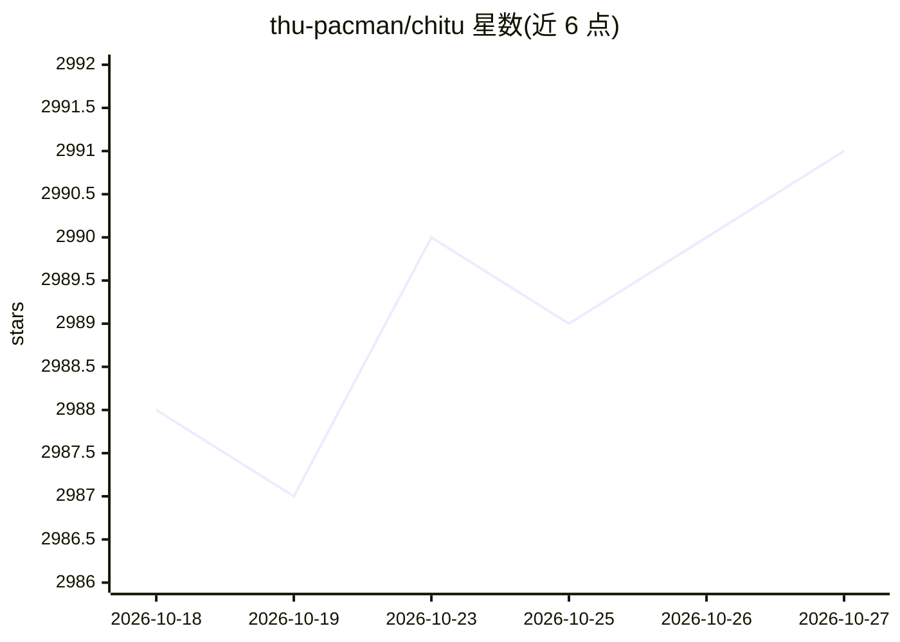

# thu-pacman/chitu

⭐ 2,991 · Python · Apache-2.0 · 推送 2026-10-23 · [GitHub](https://github.com/thu-pacman/chitu) · [官网](https://chitu.ai/) · 组织维护 · 中文 README

**面向生产环境的大模型推理引擎，支持多元算力与集群部署**

清华大学 PACMAN 团队相关的开源大模型推理框架，定位「生产级大模型推理引擎」，支持 DeepSeek、Qwen、GLM、Kimi 等模型。提供多元算力适配：NVIDIA 多系列、华为昇腾 910B、摩尔线程、沐曦、海光，并有 CPU+GPU 异构混合推理（单卡运行 DeepSeek-R1 671B）。支持 FP4/FP8 在线转 BF16 量化算子、纯 CPU 到大规模集群部署，v0.6.0 提供单文件 chitu.run 可执行文件以启动多结点、PD 分离任务。Apache 2.0 许可，并提供商业技术支持联系方式。

## 筛选速览

| 维度 | 判定 | 备注 |
|---|---|---|
| AI 角色 | `ai-ecosystem` | LLM/agent 周边工具 |
| 许可风险 | `permissive` | Apache-2.0 |
| 部署形态 | `None` |  |
| 模型依赖 | locked-api |  |
| 硬件要求 | — | 无带数字的原话,不猜 |
| 安装摩擦 | `low` | 无编译、无系统依赖或容器化 |
| 成熟度 | — | 结构信号不足 |

## 能力要点

- 支持 NVIDIA、昇腾 910B、摩尔线程、沐曦、海光等多元算力
- CPU+GPU 异构混合推理，单卡运行 DeepSeek-R1 671B
- FP4/FP8 在线转 BF16 高效算子
- chitu.run 单文件启动多结点、PD 分离部署

## 适用场景

- 在企业生产环境部署大模型推理服务
- 在国产芯片（昇腾/摩尔线程/沐曦/海光）上运行大模型
- 资源受限场景下用单卡或 CPU+GPU 混合方式运行大参数模型

## 场景标签

`推理引擎` · 领域:训练与推理

## 证据(README 行号)

> L7: Chitu「赤兔」是一个专注于效率、灵活性和可用性的高性能大模型推理框架。
> L23: 赤兔定位于「生产级大模型推理引擎」，充分考虑企业 AI 落地从小规模试验到大规模部署的渐进式需求，专注于提供以下重要特性：
> L25: - **多元算力适配**：不仅支持 NVIDIA 最新旗舰到旧款的多系列产品，也为国产芯片提供优化支持。

## 星数曲线

2026-10-18 2,988 → 2026-10-27 2,991（+3）

---
*卡片 v1 · prompt 1.4 · 生成 2026-10-20 · 置信度 high · 依据 README sha `77a87a81c3d6` · [字段定义](../../DATASET.md)*
