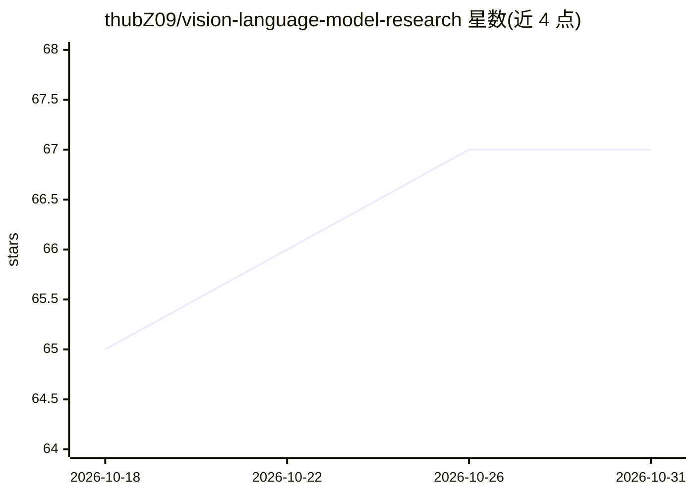

# thubZ09/vision-language-model-research

⭐ 67 · MIT · 推送 2026-03-24 · [GitHub](https://github.com/thubZ09/vision-language-model-research) · 个人维护

**视觉-语言模型研究资源清单：模型、数据集、基准与工具聚合**

面向研究者的 VLM 与多模态学习资源聚合仓库：按年份（2025/2024/2023/2022及以前）编目各代 VLM（含架构、参数量、视觉编码器、预训练骨干等事实描述），并收录训练数据集（COCO、Conceptual Captions 3M/12M 等）与基准、工具、伦理挑战及研究方向条目；README 标注为持续更新的 living resource，含目录、更新时间与贡献入口。内容为策展清单，不提供可运行代码或安装途径。

## 筛选速览

| 维度 | 判定 | 备注 |
|---|---|---|
| AI 角色 | `ai-knowledge` | 知识聚合/清单类 |
| 许可风险 | `permissive` | MIT |
| 部署形态 | `None` |  |
| 模型依赖 | — | README 未给出锁定关系 |
| 硬件要求 | — | 无带数字的原话,不猜 |
| 安装摩擦 | `low` | 无编译、无系统依赖或容器化 |
| 成熟度 | — | 结构信号不足 |

## 能力要点

- 按年份组织 2022 至 2025 各代 VLM 条目，附架构与参数信息
- 收录核心训练数据集条目（COCO、Conceptual Captions 3M/12M）
- 覆盖论文、模型、数据集、基准、工具、伦理挑战与研究方向的分类结构

## 适用场景

- 查找与比较各代视觉-语言模型的架构与规模信息
- 为多模态研究选择训练数据集与基准
- 了解 VLM 研究方向与伦理挑战的条目索引

## 场景标签

`精选清单` · 领域:学习与行业

## 证据(README 行号)

> L2:  A living resource for Vision-Language Models & multimodal learning
> L9: ## Table of contents

## 星数曲线

2026-10-18 65 → 2026-10-31 67（+2）

---
*卡片 v1 · prompt 1.4 · 生成 2026-10-24 · 置信度 high · 依据 README sha `7caefed42226` · [字段定义](../../DATASET.md)*
