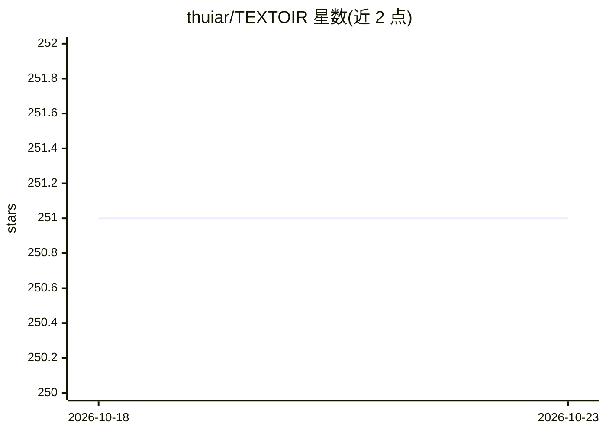

# thuiar/TEXTOIR

⭐ 251 · Python · MIT · 推送 2026-05-18 · [GitHub](https://github.com/thuiar/TEXTOIR) · [官网](https://github.com/thuiar/TEXTOIR) · 组织维护

**文本开放意图识别工具包：集成检测与发现算法供科研复现**

清华大学 THUIAR 团队发布的文本开放意图识别开源工具包（ACL 2021 论文），面向研究者复现与扩展。覆盖两项任务：开放意图检测（识别已知意图并检出开放意图）与开放意图发现（利用有限已知意图先验发现细粒度已知与开放意图聚类）。集成 2016-2026 年间 20 余种已发表论文方法，以 BERT 为骨干（部分 CV 模型替换为 BERT），提供统一数据设定与可扩展接口（方法/数据集/backbone/损失），配套可视化平台在 TEXTOIR-DEMO 仓库。安装需 conda 环境、PyTorch（CUDA 11.x）并从源码克隆运行。

## 筛选速览

| 维度 | 判定 | 备注 |
|---|---|---|
| AI 角色 | `ai-native` | 本体是模型或模型工具 |
| 许可风险 | `permissive` | MIT |
| 部署形态 | `library` | 以包/库形式分发 |
| 模型依赖 | — | README 未给出锁定关系 |
| 硬件要求 | — | 无带数字的原话,不猜 |
| 安装摩擦 | `medium` | 含编译或系统依赖之一 |
| 成熟度 | — | 结构信号不足 |

## 能力要点

- 集成 12 种开放意图检测方法与 16 种新意图发现方法
- 统一接口与数据设定，支持扩展方法/数据集/backbone/损失
- 覆盖 BANKING、OOS/CLINC150、StackOverflow 基准数据集
- 配套可视化平台 TEXTOIR-DEMO，方法持续更新至 AAAI 2026

## 适用场景

- 在基准数据集上复现开放意图检测/发现论文方法
- 为对话系统检测训练集外的未知意图
- 在统一接口下扩展并对比自定义意图识别方法

## 场景标签

`科研工具` · 领域:学习与行业

## 证据(README 行号)

> L3: TEXTOIR is the first high-quality Text Open Intent Recognition platform. This repo contains a convenient toolkit wit
> L6: TEXTOIR aims to provide a convenience toolkit for researchers to reproduce the related text open classification and 
> L82: 2. Install PyTorch (Cuda version 11.2)

## 星数曲线

2026-10-18 251 → 2026-10-23 251（+0）

---
*卡片 v1 · prompt 1.4 · 生成 2026-10-22 · 置信度 mid · 依据 README sha `4b801c6ccf31` · [字段定义](../../DATASET.md)*
