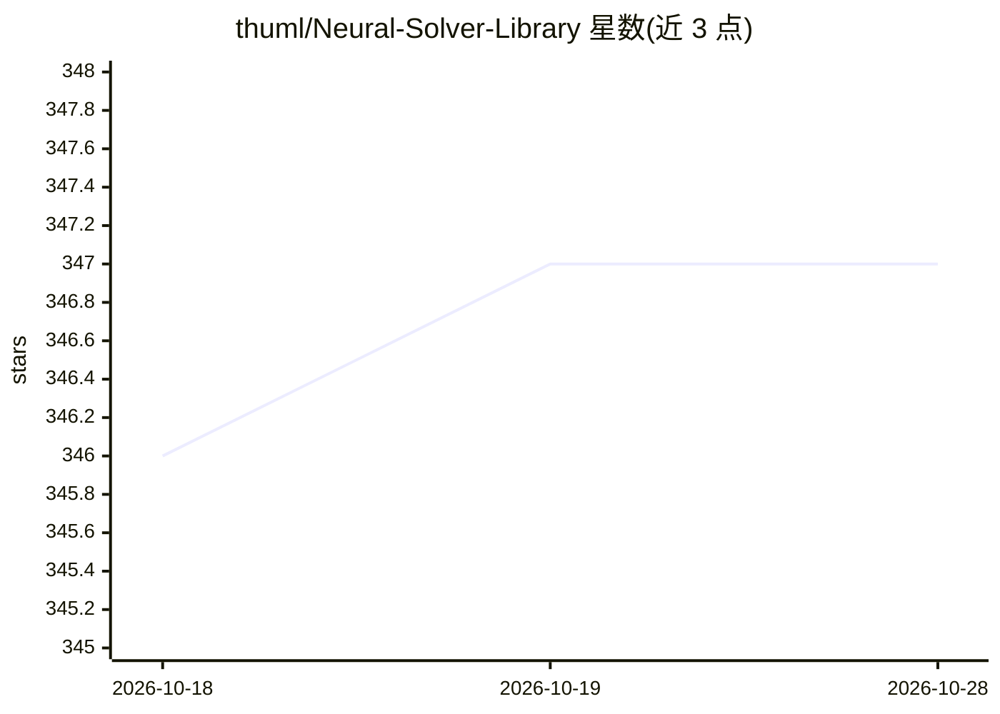

# thuml/Neural-Solver-Library

⭐ 347 · Python · MIT · 推送 2026-03-10 · [GitHub](https://github.com/thuml/Neural-Solver-Library) · 组织维护

**神经 PDE 求解器的基准评测与复现代码库**

面向深度学习研究者（神经偏微分方程求解方向）的代码库，由 Transolver 仓库扩展而来：收录 Transolver、UPT、ONO、FNO 等 13 种神经求解器，以及 Swin Transformer、U-Net、GraphSAGE、PointNet 等视觉与几何深度基线模型；支持 FNO/geo-FNO 六个标准基准、PDEBench 自回归任务与 ShapeNet-Car 工业设计任务。提供实验脚本复现各方法官方结果，开发者可按目录约定添加自己的模型。运行需 Python 3.8 并安装 requirements.txt 依赖。

## 筛选速览

| 维度 | 判定 | 备注 |
|---|---|---|
| AI 角色 | `ai-native` | 本体是模型或模型工具 |
| 许可风险 | `permissive` | MIT |
| 部署形态 | `library` | 以包/库形式分发 |
| 模型依赖 | — | README 未给出锁定关系 |
| 硬件要求 | — | 无带数字的原话,不猜 |
| 安装摩擦 | `low` | 无编译、无系统依赖或容器化 |
| 成熟度 | — | 结构信号不足 |

## 能力要点

- 收录 13 种神经 PDE 求解器与多种视觉/几何深度基线
- 支持标准基准、PDEBench 自回归任务与 ShapeNet-Car 设计任务
- 提供全部基准的实验脚本，声称可完整复现各方法官方结果
- FlashBias（NeurIPS 2025）：向 Transformer 注入可学习空间距离偏置

## 适用场景

- 对比评测多种神经 PDE 求解器在我任务上的表现
- 复现论文官方实验结果作为研究基线
- 在自己的 PDE 数据集上开发新求解器模型

## 场景标签

`模型评测` `科研工具` · 领域:评测与运维

## 证据(README 行号)

> L3: NeuralSolver is an open-source library for deep learning researchers, especially for neural PDE solvers.
> L23: - [x] **Transolver** - Transolver: A Fast Transformer Solver for PDEs on General Geometries [[ICML 2024]](https://a

## 星数曲线

2026-10-18 346 → 2026-10-28 347（+1）

---
*卡片 v1 · prompt 1.4 · 生成 2026-10-21 · 置信度 mid · 依据 README sha `7f2806d33895` · [字段定义](../../DATASET.md)*
