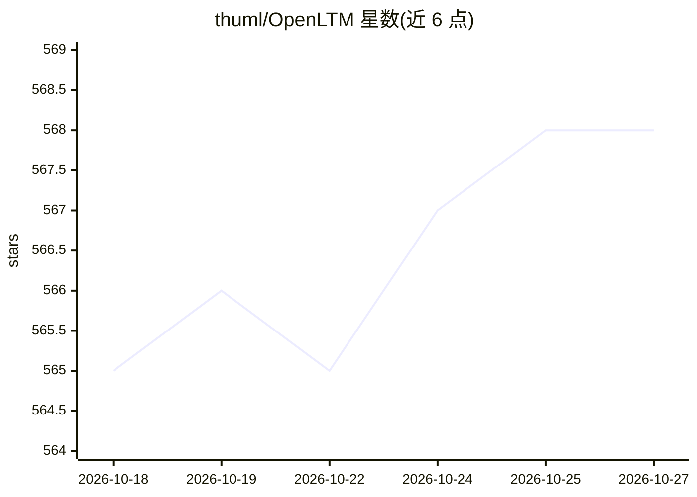

# thuml/OpenLTM

⭐ 568 · Jupyter Notebook · MIT · 推送 2026-03-22 · [GitHub](https://github.com/thuml/OpenLTM) · 组织维护 · 中文 README

**大型时间序列模型的实现、预训练代码与数据集代码库**

清华大学 THUML 团队维护的开源代码库，提供开发与评测时间序列基础模型（LTM/TSFM）的流水线：收录 Timer、Timer-XL、Moirai、Moment、GPT4TS 等 10 余个模型的实现（部分已勾选完成、部分为待办），提供在 260B 时间点上预训练的 Timer checkpoint（PyTorch 版）、UTSD/ERA5 等预训练数据集、监督训练/预训练/适配脚本，并支持通过添加模型文件扩展新模型。论文 Timer 发表于 ICML 2024。

## 筛选速览

| 维度 | 判定 | 备注 |
|---|---|---|
| AI 角色 | `ai-native` | 本体是模型或模型工具 |
| 许可风险 | `permissive` | MIT |
| 部署形态 | `library` | 以包/库形式分发 |
| 模型依赖 | — | README 未给出锁定关系 |
| 硬件要求 | — | 无带数字的原话,不猜 |
| 安装摩擦 | `low` | 无编译、无系统依赖或容器化 |
| 成熟度 | — | 结构信号不足 |

## 能力要点

- 收录 10+ 个时间序列基础模型实现（Timer、Timer-XL、Moirai、Moment 等）
- 提供 260B 时间点预训练的 Timer checkpoint 与预训练代码
- UTSD（10 亿时间点）与 ERA5 等预训练数据集
- 监督训练/预训练/适配脚本与自定义模型扩展机制

## 适用场景

- 对时间序列基础模型进行预训练或微调适配
- 复现或对比 Timer/Moirai/Moment 等模型的预测效果
- 在其流水线上开发自己的大型时间序列模型

## 场景标签

`模型训练` `微调` · 领域:训练与推理

## 证据(README 行号)

> L3: OpenLTM is an open codebase aiming to provide a pipeline to develop and evaluate large time-series models.
> L25: - [x] **Timer-XL** - Timer-XL: Long-Context Transformer for Unified Time Series Forecasting. [[ICLR 2025]](https://
> L27: - [x] **Timer** - Timer: Generative Pre-trained Transformers Are Large Time Series Models. [[ICML 2024]](https://ar

## 星数曲线

2026-10-18 565 → 2026-10-27 568（+3）

---
*卡片 v1 · prompt 1.4 · 生成 2026-10-21 · 置信度 high · 依据 README sha `af19d66f9619` · [字段定义](../../DATASET.md)*
