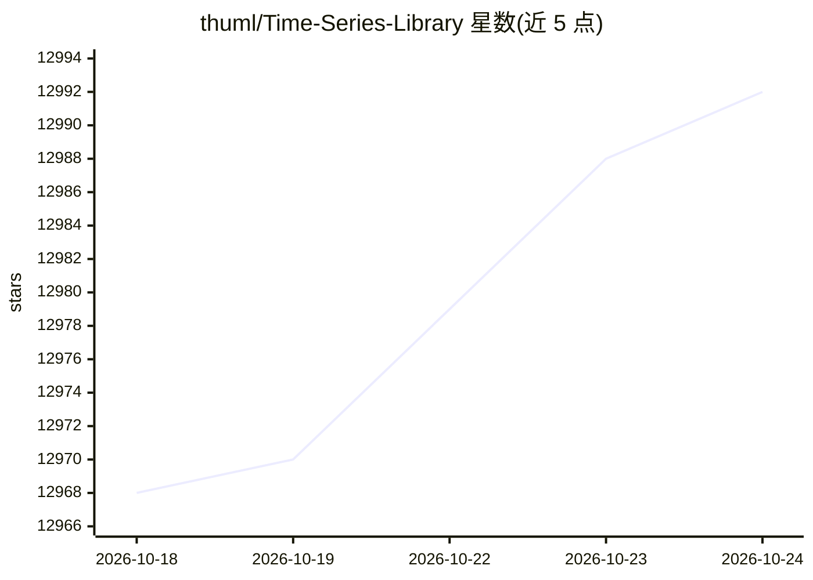

# thuml/Time-Series-Library

⭐ 12,992 · Python · MIT · 推送 2026-04-18 · [GitHub](https://github.com/thuml/Time-Series-Library) · 组织维护 · 中文 README

**面向深度学习研究者的时间序列分析模型库与基准**

清华大学 THUML 实验室维护的开源时间序列库：提供统一代码库，覆盖五类主流任务——长短期预测、插补、异常检测与分类，收录 TimeXer、TimesNet、iTransformer、TimeMixer 等数十个模型实现，并维护各任务前三名排行榜；支持开发自有模型、零样本预测脚本评估大时间序列模型。通过 pip 或源码安装，社区贡献了 Docker 部署。2026 年 4 月公告：维护者带宽有限，不再积极新增功能，基准部分被建议替换为更新基准，但基线实现保持正确。

## 筛选速览

| 维度 | 判定 | 备注 |
|---|---|---|
| AI 角色 | `ai-native` | 本体是模型或模型工具 |
| 许可风险 | `permissive` | MIT |
| 部署形态 | `self-host` | docker 或自建部署 |
| 模型依赖 | — | README 未给出锁定关系 |
| 硬件要求 | — | 无带数字的原话,不猜 |
| 安装摩擦 | `low` | 无编译、无系统依赖或容器化 |
| 成熟度 | — | 结构信号不足 |

## 能力要点

- 覆盖预测/插补/异常检测/分类五类任务
- 收录 TimeXer、TimesNet、iTransformer 等数十个模型实现
- 维护分任务、分回看长度的模型排行榜
- 提供零样本预测脚本用于评估大时间序列模型

## 适用场景

- 我要做时间序列预测模型的实验对比
- 我想在同一代码框架下开发自己的时间序列模型
- 我需要可复现的基线实现做异常检测或插补任务

## 场景标签

`模型评测` · 领域:评测与运维

## 证据(README 行号)

> L2: TSLib is an open-source library for deep learning researchers, especially for deep time series analysis.
> L6: We provide a neat code base to evaluate advanced deep time series models or develop your model, which covers five ma

## 星数曲线

2026-10-18 12,968 → 2026-10-24 12,992（+24）

---
*卡片 v1 · prompt 1.4 · 生成 2026-10-20 · 置信度 high · 依据 README sha `c99998376618` · [字段定义](../../DATASET.md)*
