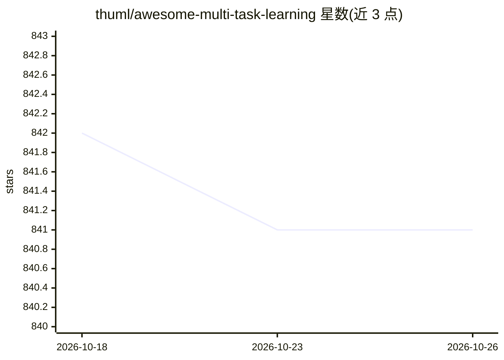

# thuml/awesome-multi-task-learning

⭐ 841 · 推送 2026-03-03 · [GitHub](https://github.com/thuml/awesome-multi-task-learning) · [官网](https://github.com/thuml/awesome-multi-task-learning) · 组织维护

**多任务学习（MTL）数据集、代码库与论文的策展清单**

由 thuml（清华大学机器学习组）维护的多任务学习资源汇总：从机器学习视角收录综述论文、基准与数据集（覆盖计算机视觉、NLP、强化学习与机器人、图、推荐系统）、开源代码库（LibMTL、TorchJD、MTReclib 等），以及按硬/软参数共享、解码器、调制与适配器、MoE 与路由等类别组织的论文条目，部分条目附 ✨ 标记。清单形式，无安装运行内容，面向 MTL 研究者检索文献与代码。

## 筛选速览

| 维度 | 判定 | 备注 |
|---|---|---|
| AI 角色 | `ai-knowledge` | 知识聚合/清单类 |
| 许可风险 | `none` | — |
| 部署形态 | `None` |  |
| 模型依赖 | — | README 未给出锁定关系 |
| 硬件要求 | — | 无带数字的原话,不猜 |
| 安装摩擦 | `low` | 无编译、无系统依赖或容器化 |
| 成熟度 | — | 结构信号不足 |

## 能力要点

- 覆盖 CV/NLP/RL/图/推荐五个领域的数据集条目
- 收录 LibMTL、TorchJD、MTReclib 等通用与专用代码库
- 论文按硬参数共享、软参数共享、解码器、适配器、MoE 等架构类别组织

## 适用场景

- 做多任务学习研究时查找综述和按方法分类的论文
- 为实验寻找 MTL 基准数据集与开源实现
- 了解适配器、LoRA、MoE 等参数高效方法在 MTL 中的论文脉络

## 场景标签

`精选清单` · 领域:学习与行业

## 证据(README 行号)

> L3: A curated list of datasets, codebases, and papers on Multi-Task Learning (MTL), from a Machine Learning perspective.
> L24: ## Benchmark & Dataset

## 星数曲线

2026-10-18 842 → 2026-10-26 841（-1）

---
*卡片 v1 · prompt 1.4 · 生成 2026-10-21 · 置信度 high · 依据 README sha `d8cb4c80d298` · [字段定义](../../DATASET.md)*
