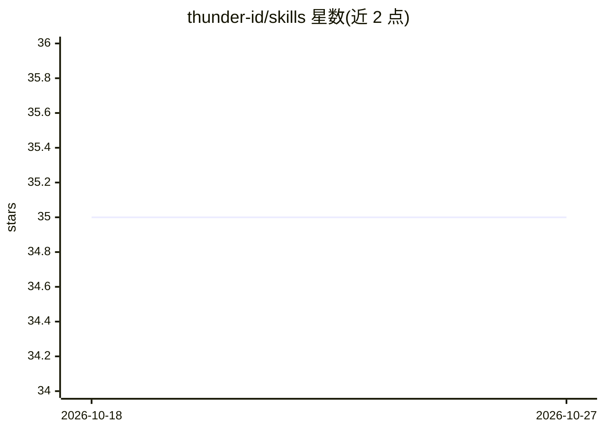

# thunder-id/skills

⭐ 35 · Apache-2.0 · 推送 2026-08-18 · [GitHub](https://github.com/thunder-id/skills) · 组织维护

**ThunderID 的 agent 技能与插件集，帮助开发者接入身份服务**

为使用 ThunderID（含 Wayfinder B2C 登录、AgentID AI agent 认证）的开发者提供的 agent 技能与插件集合：包含 12 个技能，覆盖安装启动 ThunderID 服务、运行消费者登录与 AI agent 认证演示，以及 React/Next.js/Express/Vue/Nuxt/Node/iOS/Android/Flutter 等框架的 SDK 集成。通过 Claude Code 插件市场、Codex 插件市场或 npx skills CLI 安装，用户以自然语言指示 agent 调用对应技能。Apache-2.0 许可。

## 筛选速览

| 维度 | 判定 | 备注 |
|---|---|---|
| AI 角色 | `ai-ecosystem` | LLM/agent 周边工具 |
| 许可风险 | `permissive` | Apache-2.0 |
| 部署形态 | `library` | 以包/库形式分发 |
| 模型依赖 | — | README 未给出锁定关系 |
| 硬件要求 | — | 无带数字的原话,不猜 |
| 安装摩擦 | `low` | 无编译、无系统依赖或容器化 |
| 成熟度 | — | 结构信号不足 |

## 能力要点

- 12 个技能覆盖 ThunderID 安装、两套演示（B2C 登录、AgentID 认证）与 10 类框架集成
- 支持 Claude Code、Codex 插件市场与 npx skills CLI 三种安装途径
- 自然语言触发技能的使用映射表（如 'Set up ThunderID on my machine'）

## 适用场景

- 让 coding agent 一句话完成 ThunderID 服务的安装与启动
- 通过 agent 快速运行消费者登录或 AI agent 认证演示
- 在各前端/移动框架中集成 ThunderID SDK

## 场景标签

`Agent 框架` · 领域:Agent 开发

## 证据(README 行号)

> L29: |Skill|Purpose|When to Use|
> L31: |`thunderid-install`|Install and start the ThunderID server|New projects, initial setup|

## 星数曲线

2026-10-18 35 → 2026-10-27 35（+0）

---
*卡片 v1 · prompt 1.4 · 生成 2026-10-25 · 置信度 high · 依据 README sha `f15c28908f80` · [字段定义](../../DATASET.md)*
