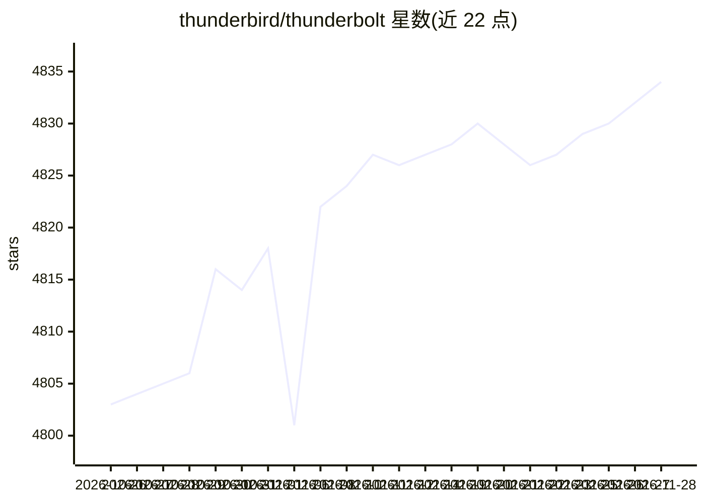

# thunderbird/thunderbolt

⭐ 4,834 · TypeScript · MPL-2.0 · 推送 2026-11-27 · [GitHub](https://github.com/thunderbird/thunderbolt) · [官网](https://thunderbolt.io) · 组织维护

**开源自托管多平台 AI 客户端：自选模型、本地掌控数据**

Thunderbolt 是一个开源、跨平台的 AI 客户端，可在任意环境本地部署（on-prem），支持云端前沿模型、本地模型与自托管模型。客户端功能包括项目工作区、技能指令包、模型内嵌 Widget、HTML Artifacts、语音模式、MCP 服务器连接、ACP 外部编码代理接入、多设备同步与端到端加密。附带单二进制终端编码代理 thunderbolt（通过 ACP/MCP 桥接到应用）。提供 Docker Compose、Kubernetes、Pulumi (AWS) 三种自托管部署路径，后端基于 Postgres 与 PowerSync。

## 筛选速览

| 维度 | 判定 | 备注 |
|---|---|---|
| AI 角色 | `ai-ecosystem` | LLM/agent 周边工具 |
| 许可风险 | `permissive` | MPL-2.0 |
| 部署形态 | `self-host` | docker 或自建部署 |
| 模型依赖 | — | README 未给出锁定关系 |
| 硬件要求 | — | 无带数字的原话,不猜 |
| 安装摩擦 | `low` | 无编译、无系统依赖或容器化 |
| 成熟度 | — | 结构信号不足 |

## 能力要点

- 支持前沿模型、本地模型与 on-prem 模型接入
- Web/iOS/Android/Mac/Linux/Windows 全平台可用
- MCP 服务器连接与 ACP 编码代理接入
- 本地优先 SQLite 存储，可选同步与端到端加密

## 适用场景

- 企业内网自托管部署 AI 客户端以掌控数据
- 在统一的客户端中切换使用云端或本地模型
- 通过 MCP/ACP 让模型连接外部工具与编码代理

## 场景标签

`AI 助手` · 领域:对话与助手

## 证据(README 行号)

> L7: Thunderbolt is an open-source, cross-platform AI client that can be deployed on-prem anywhere.
> L10: - 🧠 Compatible with frontier, local, and on-prem models.
> L41: - CLI — `thunderbolt`, the single-binary terminal coding agent, and the ACP/MCP bridge that connects it to the app

## 星数曲线

2026-10-26 4,803 → 2026-11-28 4,834（+31）

---
*卡片 v1 · prompt 1.4 · 生成 2026-11-22 · 置信度 high · 依据 README sha `c6483a51ee69` · [字段定义](../../DATASET.md)*
