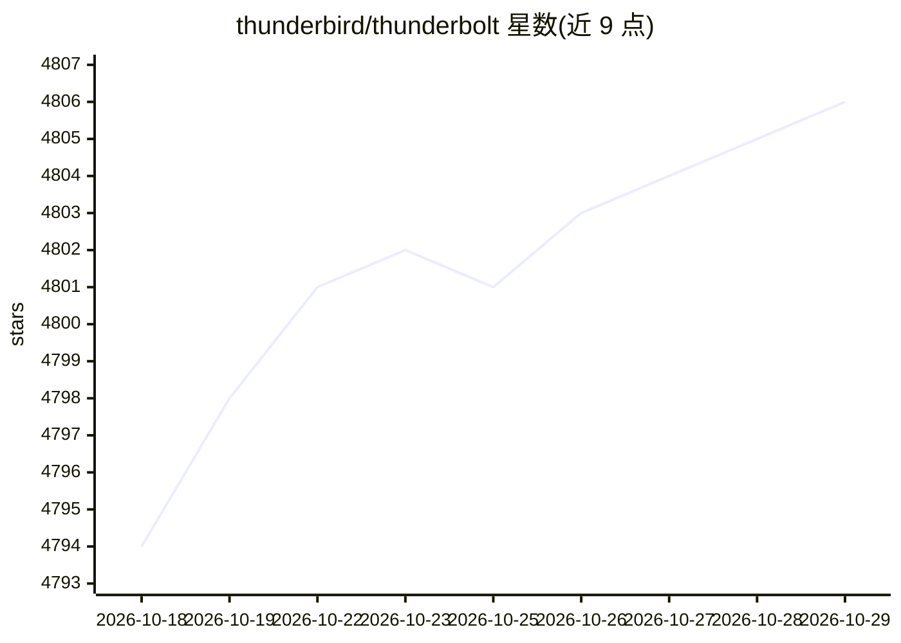

# thunderbird/thunderbolt

⭐ 4,806 · TypeScript · MPL-2.0 · 推送 2026-10-28 · [GitHub](https://github.com/thunderbird/thunderbolt) · [官网](https://thunderbolt.io) · 组织维护

**开源跨平台 AI 聊天客户端：自带模型可选本地推理，可私有化部署**

Thunderbird 维护的开源跨平台 AI 客户端，覆盖 web、iOS、Android、Mac、Linux、Windows，面向企业本地化部署。支持接入前沿模型、本地模型与任意 OpenAI 兼容 provider，可指向 Ollama 或 llama.cpp 做本地推理；提供 Projects、Skills、Widgets、HTML Artifacts、语音模式、MCP 连接、ACP agent、端到端加密多设备同步等功能，并附 CLI 终端编码 agent。自托管提供 Docker Compose、Kubernetes、Pulumi 三种部署目标。README 声明项目尚处早期、正进行安全审计；当前依赖认证与搜索后端，系统托管模型需 ANTHROPIC_API_KEY 与 TINFOIL_API_KEY。

## 筛选速览

| 维度 | 判定 | 备注 |
|---|---|---|
| AI 角色 | `ai-native` | 本体是模型或模型工具 |
| 许可风险 | `permissive` | MPL-2.0 |
| 部署形态 | `self-host` | docker 或自建部署 |
| 模型依赖 | local-ok | 支持本地模型 |
| 硬件要求 | — | 无带数字的原话,不猜 |
| 安装摩擦 | `low` | 无编译、无系统依赖或容器化 |
| 成熟度 | `idea` | |

## 能力要点

- 兼容前沿、本地与本地部署模型，支持 Ollama/llama.cpp 免费本地推理
- MCP 连接与 ACP 外部编码 agent 接入
- 本地优先 SQLite、可选同步与端到端加密
- Docker Compose/Kubernetes/Pulumi 三种自托管部署目标

## 适用场景

- 企业在自有基础设施上部署可控的 AI 客户端
- 个人用本地模型进行聊天与语音对话，数据不出本地
- 通过 MCP/ACP 扩展模型可调用的工具与编码 agent

## 场景标签

`聊天机器人` `AI 助手` · 领域:对话与助手

## 证据(README 行号)

> L13: Thunderbolt is an open-source, cross-platform AI client that can be deployed on-prem anywhere.
> L11: > - Thunderbolt ships system-managed models that the backend serves on your behalf: Opus 5.5, routed to Anthropic, 
> L16: - 🧠 Compatible with frontier, local, and on-prem models.

## 星数曲线

2026-10-18 4,794 → 2026-10-29 4,806（+12）

---
*卡片 v1 · prompt 1.4 · 生成 2026-10-20 · 置信度 high · 依据 README sha `f0a669e7e7c2` · [字段定义](../../DATASET.md)*
