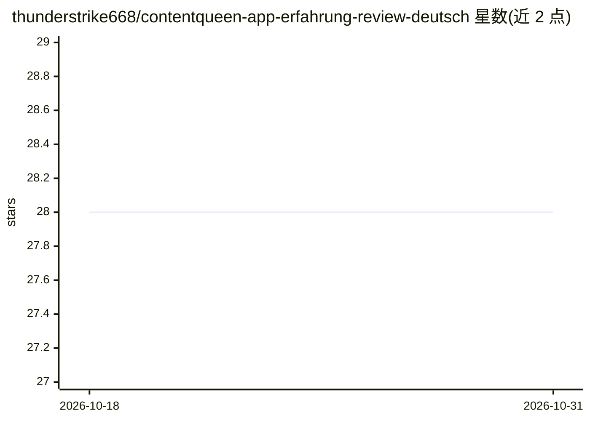

# thunderstrike668/contentqueen-app-erfahrung-review-deutsch

⭐ 28 · 推送 2026-09-13 · [GitHub](https://github.com/thunderstrike668/contentqueen-app-erfahrung-review-deutsch) · 个人维护

**面向德语区营销者的 KI 文案生成 App 推广页**

德语 README，介绍名为 Contentqueen App 的 KI 文案生成服务：面向 Performance/Affiliate 营销者、独立创业者、社媒管理者与内容创作者，声称基于 PAS/AIDA/BAB 等 Direct-Response 文案框架生成广告文案、邮件、社媒帖子，并自动将同一内容改写为 X/LinkedIn/TikTok 等多平台格式。页面为营销推广性质，全文以行动号召与链接收尾，未提供安装方式、代码、技术机制或运行说明，也无 API/模型细节可验证。

## 筛选速览

| 维度 | 判定 | 备注 |
|---|---|---|
| AI 角色 | `ai-native` | 本体是模型或模型工具 |
| 许可风险 | `none` | — |
| 部署形态 | `None` |  |
| 模型依赖 | — | README 未给出锁定关系 |
| 硬件要求 | — | 无带数字的原话,不猜 |
| 安装摩擦 | `low` | 无编译、无系统依赖或容器化 |
| 成熟度 | — | 结构信号不足 |

## 能力要点

- 声称基于 PAS/AIDA/BAB 等文案框架生成转化导向文案
- 声称将同一内容自动改写为多平台格式（X/LinkedIn/TikTok/邮件）
- 面向德语区营销者与创作者，声称无需 Prompt-Engineering 知识

## 适用场景

- 营销者快速生成广告文案与邮件文案
- 同一创意一键改写为多平台社媒内容
- 创作者按高频节奏产出博客与 Newsletter 内容

## 场景标签

`AI 写作` · 领域:内容生成

## 证据(README 行号)

> L1: # Contentqueen App: Der ultimative KI-Content-Generator für Marketer & Creators
> L21: Die **Contentqueen App** bietet hier einen drastisch intelligenteren Weg. Sie ist nicht einfach nur ein weiteres ei
> L31: Die meisten Standard-Textgeneratoren liefern brave, passive und akademisch klingende Formulierungen. Sie schreiben 

## 星数曲线

2026-10-18 28 → 2026-10-31 28（+0）

---
*卡片 v1 · prompt 1.4 · 生成 2026-10-26 · 置信度 low · 依据 README sha `066d2a8298bb` · [字段定义](../../DATASET.md)*
