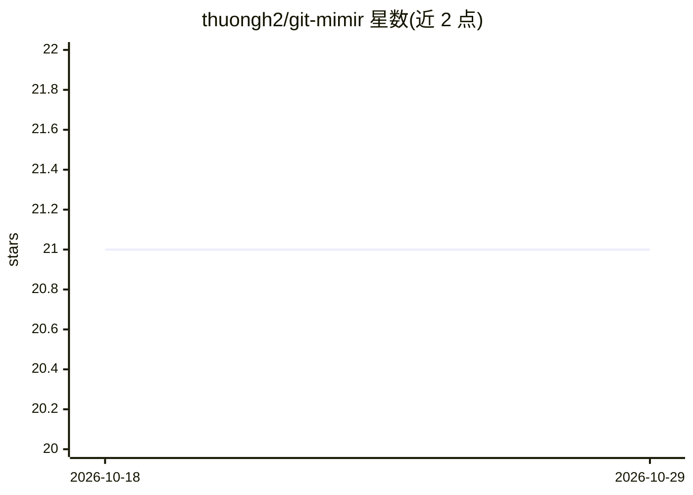

# thuongh2/git-mimir

⭐ 21 · Go · 推送 2026-04-13 · [GitHub](https://github.com/thuongh2/git-mimir) · [官网](https://github.com/thuongh2/git-mimir) · 个人维护

**Go 编写的代码知识图谱引擎，经 MCP/API 供 AI 检索代码**

用 Go 编写的代码情报引擎：将仓库索引为知识图谱（支持 TS/JS/Go/Python/Rust/Java/C/C++ 8 种语言，基于 tree-sitter AST 解析与 git-diff 增量索引），通过 MCP（12 个工具，含混合搜索、影响面分析、重命名规划）、HTTP API 与内嵌 Web UI 暴露给 AI agent 与开发者。可选嵌入向量检索（需 ollama 或 OpenAI），存储用纯 Go SQLite 与 sqlite-vec，Louvain 社区聚类。提供一键安装脚本、go install 与源码构建方式，`mimir setup` 自动配置多种编辑器接入。

## 筛选速览

| 维度 | 判定 | 备注 |
|---|---|---|
| AI 角色 | `ai-ecosystem` | LLM/agent 周边工具 |
| 许可风险 | `none` | — |
| 部署形态 | `library` | 以包/库形式分发 |
| 模型依赖 | local-ok | 支持本地模型 |
| 硬件要求 | — | 无带数字的原话,不猜 |
| 安装摩擦 | `low` | 无编译、无系统依赖或容器化 |
| 成熟度 | — | 结构信号不足 |

## 能力要点

- 仓库索引为知识图谱，支持 8 种语言的 tree-sitter AST 解析
- MCP 提供 12 个工具：混合搜索（BM25+向量）、影响面/爆炸半径分析、跨仓查询
- git-diff 增量再索引与 Louvain 社区聚类
- 自动配置 Claude Code、VS Code、Cursor 等编辑器与 agent hooks

## 适用场景

- 让 AI 编程 agent 通过 MCP 语义检索并理解大型代码库
- 重构前做影响面分析，查看改动会波及哪些调用方
- 在 Web UI 中可视化浏览代码结构与符号关系

## 场景标签

`知识图谱` `语义搜索` · 领域:知识与检索

## 证据(README 行号)

> L3: Mimir is a **Go-based code intelligence engine** that indexes your repository into a knowledge graph and exposes it 
> L11: |**AI Agents (MCP)**|7 tools for semantic search, impact analysis, and blast radius queries|
> L98: AI agents get access to 12 tools via MCP:

## 星数曲线

2026-10-18 21 → 2026-10-29 21（+0）

---
*卡片 v1 · prompt 1.4 · 生成 2026-10-28 · 置信度 high · 依据 README sha `e76e3faaea1c` · [字段定义](../../DATASET.md)*
